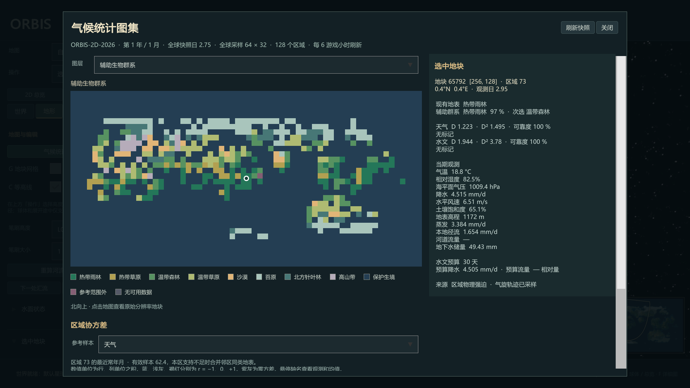
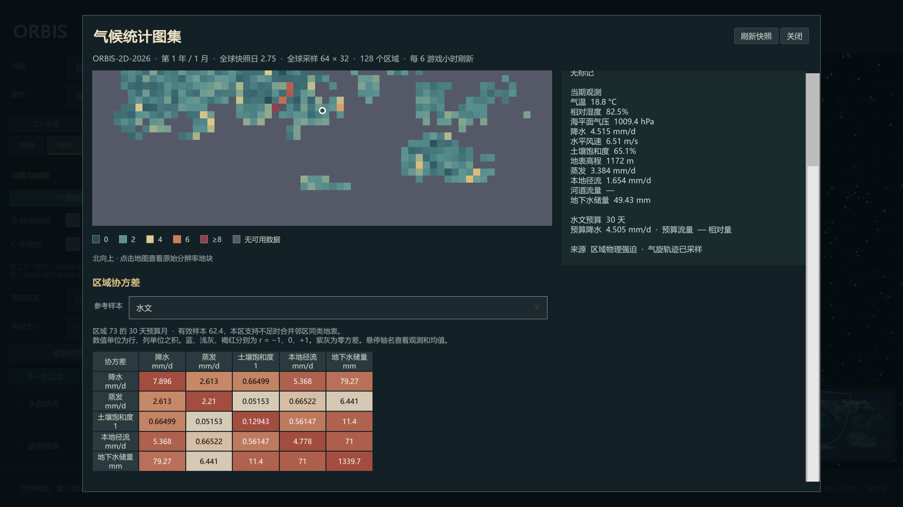

# ORBIS 气候统计分析

## 架构审计与实施计划

本轮面向 `Orbis2DWorld` 的权威 `WorldData`。所有坐标沿用南行在前的球面经纬栅格、周期经度及现有局部展开。诊断以只读方式消费物理量，统计派生量可从世界数据重建。

| 功能 | 现有实现及依赖 | 接入时需要处理的问题 |
|---|---|---|
| 星球与世界生成 | `FlatAtlasTerrain.Read` 或 `FlatGenerator` 生成高程，`FlatGenerator.Rebuild` 构建气候、排水与地形事实 | 引用世界、地形版本与当前季节共同约束缓存寿命 |
| 长期气候 | `FlatClimate` 按纬度、海陆热容、地形递减率和季节生成月温。`FlatMoisture` 计算海陆热力差、风带、水汽输送、抬升、蒸发与凝结。`KoppenClassifier` 读取 12 个月温度和降水 | 30 天为一月，360 天为一年。规定的环流与参数化热力场都有模型误差 |
| 天气与大气 | 主游戏使用 `FlatClimateYear` 和六小时步进的 `FlatCycloneWeather`。另有 `FlatWeatherSimulation` 适配 64×32、12 层的 `OrbisAtmosphereCore`。`FlatSkyRenderer` 和 HP 云为表现层 | 分开月正常值、当期强迫、已求解的瞬时状态和降雨画面。统计离群分数用作诊断 |
| 水文、河湖与海洋 | `FlatHydrology` 建排水图与湖盆。`FlatRiverDischarge` 计算雪、土壤、浅层蓄水、蒸发和汇流。`FlatRiverCurves` 生成河道。`FlatShallowWater` / `FlatLocalWater` 提供独立局地水面模拟，SW3 提供渲染 | 水柱以毫米计，河流是项目定义的相对流量。统计读取物理结果，水量守恒仍由原模型负责 |
| 生物群系 | `FlatTerrainAnalysis.ClassifyBiome` 将柯本、海拔、积温和淡水条件结合，`FlatEcology` 生成植被和季节数据 | 参考分布记录来源和适用范围，水域、冰雪与湿地等局部条件须保留 |
| 渲染、分块、LOD | `FlatMapRenderer` 与 `FlatMapRenderJobs` 按 32×32 脏块上传，`FlatScrollNavigator` 管理局部投影。旧星球路径另有 `OrbisChunkView`、`OrbisSurfaceLOD` | 地图缩放和顶点刷新不应触发统计训练 |
| 并行架构 | 核心程序集为纯 C#，`FlatWorkerPolicy` 管理 CPU 工作者，贴图打包用 Burst `IJobParallelFor`。体积云运行 GPU 着色器 | 当前诊断输入驻留 CPU。先测全球网格、区域更新和缓存命中，再决定计算位置 |

本次升级按六个阶段实施。

1. 核实以上模块、单位、存档版本和编译基线。
2. 用独立的双精度在线统计核心实现联合样本的均值、协方差、相关性和高斯评分，覆盖对称性、奇异矩阵、尺度、仿射变换和坏输入。
3. 从项目的气候及生态标签校准可替换的生物群系参考，输出最相似类别、支持度和连续过渡。
4. 在低分辨率网格建立相同季节、地表与区域的参考分布，用当期物理输入评分，保留局部细查和来源标记。
5. 复用水柱与河流流量进行水文联合诊断，对比读写前后的守恒与存档字节。
6. 按需发布诊断图、区域协方差和可靠性，测首次构建、增量更新、热查询与关闭诊断时的开销。在 Unity 检查实际入口和显示，再运行原有回归。

## 在游戏中使用

运行 `Orbis2DWorld`，选择 **地形 → 气候统计图集**。默认地图为北向上，点击一个位置可读取该处原始分辨率地块。图例给出当前变量的单位和色阶。矩阵显示原单位的协方差，颜色表示 Pearson 相关系数，悬停可读精确值。水文矩阵使用当月水量收支对应的降水与测站流量。

十个图层包括物理变量、温度与降水的相关性、辅助生物群系、候选群系支持度，以及天气和水文各自的马氏距离、异常类型和参考可靠度。物理变量下可选择十一项。海上没有陆地土壤储水，未设测站的地块没有河道流量。在图集中这些位置显示为无数据。



## 物理输入与时间尺度

热量、水汽来源与输送、盛行风向、地形抬升和海陆热容决定月温与月降水。现有柯本分类读取这组月正常值。新的统计层在其上给出生境的相似程度，并读取当前天气和水文的偏离程度。渲染器、风暴生成、文明模拟和排水路由均没有统计评分写回入口。

| 观测或参考 | 来源、单位与时间支持 |
|---|---|
| 月气候正常值 | 已保存的月均温度 °C、月累计水当量 mm、气柱相对湿度 0–1、水平风矢量。按原模型的换算将风速报告为 m/s，将 30 天累计降水除以 30 报告为等效 mm/d。海平面气压用现有大气强迫方程计算，单位 hPa |
| 当期区域天气 | 插值相邻月，叠加 `FlatClimateYear` 的年际温度与降水扰动。风与气压包含与当前时钟吻合的已跟踪气旋影响，其局地范围由中心压差、峰值风速和核心半径估算。湿度仍然来自月湿度场 |
| 分层大气的一步 | `FlatWeatherSimulation.Instantaneous` 读最低预报层（0–300 m）的温湿风、海平面气压、一步内到达地面的雨雪水当量。降水以 mm/d 表示，同时记录真实积分窗。0.1 个求解器秒对应 4.5 个物理秒 |
| 陆地月水账 | 同一个雪、土壤及浅层地下水水柱。蒸发与汇流前本地产水为 mm/d，土壤饱和度为 0–1，地下水为 mm。重放先前 24 个月及目标月的气候强迫，读取目标月的输入和储量变化 |
| 河流、湖泊 | 河道与湖出口的月均流量使用既有汇流单位。一单位相当于每年 1,200 mm 降水落在一个平均面积网格上的体积流率。湖泊可读液态水限制的蒸发及本地产水。海底或地表高程均为米 |

天气图集把当期强迫与最近一组月正常值的**区域空间分布**比较，每月中点切换天气参考。水文始终使用包含所选日期的整月，只有实际有站的地块参与流量分布。缺测整行从该特征组合剔除，实测零流量则保留。

需要分析分层天气时，在已有求解器的所有者线程创建 `new ClimateWeatherHistory(solver)`。它订阅完成步，按月份、8×8 区域及水陆分别累积既往瞬时样本。默认每六个游戏小时最多收一帧，并要求相邻采样至少隔 60 个物理秒。至少有八个先前采样时段才发布评分，此后每八帧重拟合。同帧的所有地块共用入样前冻结的模型。时间回退或求解器恢复会清空历史，`Dispose()` 取消订阅。普通游戏读取区域天气时无需启动分层求解器。

## 数学实现

* `ClimateFeatureSet` 允许每个子系统选择轴、正比例尺度与变换。正偏态非负变量可采用 `log(1+x/scale)`，带符号的气温及高程可用线性轴。默认天气选温、湿、压、降水、风速。默认陆地水文选降水、蒸发、土壤饱和度、本地产水、地下水，河道再加测站流量。相同轴名不能重复配置。
* 未加权样本协方差为 **S = Σ(x−μ)(x−μ)ᵀ/(N−1)**。面积或可靠度权重使用 **W = Σw，D = W−Σw²/W，S = Σw(x−μ)(x−μ)ᵀ/D**。有效样本数为 **W²/Σw²**。单行按加权 Welford 更新，分区按 Chan 公式合并，两个分区之间的修正项为 **(W₁W₂/W)(μ₂−μ₁)(μ₂−μ₁)ᵀ**。实现保存均值的舍入残差，并按尺度计算权重和协方差，避免大权重单位使中间乘积溢出。只更新一个三角区，对称两项读取同一个值。
* 原始轴和需要的变换轴共享一条原子更新记录。观测缺失或运算溢出时舍弃该行。矩阵热图取原始轴的协方差。评分取所选变换后的坐标。Pearson 系数为 **Sᵢⱼ/(σᵢσⱼ)**。常数轴的相关性无定义，数值接口返回 0，界面单独标注。
* 拟合先在标准差尺度上检查矩阵对称性与半正定性。默认用 **Rλ = (1−λ)R + λI，λ=0.02** 收缩相关矩阵。有效子空间内算一次 **LLᵀ=Rλ**，用前代求 **Ly=(x−μ)/σ**，得到 **D²=yᵀy** 及 **D=√D²**。二维返回欧氏距离的例子是单位协方差下的点 (3,4)，其距离为 5。对数行列式计入原始标准差。重复特征在配置时被拒绝，常数轴、秩亏及数值降级会降低支持度。完全无变化或无充分支持的分布不予评分。
* 未正则化的满秩模型在同时变换样本、均值及协方差时保持可逆线性变换不变性。按坐标轴进行的对数变换或收缩改变模型，因此只对相应的假设做不变性测试。
* 方向信号默认阈值为各变量在评分坐标中的 2 个标准差。联合距离还可发现单个指标正常、变量间搭配却罕见的样本。降水低且土壤、地下水或径流也低时标注干旱风险。径流偏高并伴随高降水或高流量时标注潜在洪涝。这里的可靠度是由有效样本数、原始秩和降级情况构成的支持指数。真实风暴的生成、发展及消散继续由气旋模型决定。

## 生物群系校准

默认参考从当前 ORBIS 世界的可分类地块、既有生态标签和十二个月的气候正常值拟合。每个样本按纬度面积加权，每类需要至少 12 个有效样本。六个特征依次为年均温 °C、年降水 mm、年内月均温差 °C、月降水变异系数、纬度绝对值 °、海拔 m。年总量只进入生物群系参考。

在适用范围内，候选类的对数权重为 **log πₖ − ½(log det Sₖ + Dₖ²) + log 邻域权重**。πₖ 取各训练类所占面积。四个球面邻格最多提供 1.5 倍支持，海陆性与高程差会降低邻格影响，经度线及极点使用世界已有的球面邻接。归一化后保留各类概率以及首选和次选。最高概率低于 0.60 标为过渡区。水域、冰雪、湿地及干区淡水维持的植被优先保留其已有局部生境。

自动校准时，六轴附加的平滑标准差分别为 1 °C、60 mm、1 °C、0.05、1°、100 m。适用范围从训练轴极值扩展，并限制在有效物理范围。六维距离筛选阈值为 D²≤22.458，取 χ²(6) 的 99.9% 分位作为外推门槛。这些阈值属于项目参数。默认高山参考来自海拔至少 2,680 m、最暖月不超过 10 °C 的无冰高地。实际生态线可随地区校准。

参考可替换，均值、行优先协方差、先验、每轴最小最大值、来源、单位顺序和样本支持信息均随导出对象交付。保留实际数据来源，按 `FeatureSchema` 转换单位后导入。数据损坏、单位模式错误、先验无效或协方差不合要求时导入会失败。

```csharp
// calibratedRows 可来自 ExportReferences()，或由观测资料按 FeatureSchema 制备。
if (!FlatBiomeStatistics.TryFromReferences(calibratedRows, out var calibratedBiomes))
    throw new ArgumentException("请检查参考数据的单位模式、来源、协方差和适用范围。");
app.ShowClimateStatistics(calibratedBiomes);

// 在一个工作线程上使用相同的参考和自选天气特征。
var axes = new ClimateFeatureSet(new ClimateAxis(ClimateFeature.Temperature),
    new ClimateAxis(ClimateFeature.Humidity), new ClimateAxis(ClimateFeature.Pressure));
var atlas = new FlatClimateStatistics(world, cancel, width:64, biomes:calibratedBiomes, weather:axes);
atlas.Refresh(day, capturedCyclones, cancel);
var local = atlas.Inspect(nativeTile, day, capturedCyclones);
```

在默认 512×256 图集上，八类均获得参考，每类有 1,028 至 6,169 个原始训练样本。对全部 131,072 个原生地块查询，有 24,742 个具有明确首选、2,458 个属于过渡区、85 个超出参考范围、103,787 个属于受保护地表。另一张 64×32 测试世界只支持六类。系统保留缺项。

## 网格、缓存与实测开销

默认从 CPU 中的世界数组选取 64×32 个中心样点，按 4×4 样点划出 128 个区域。每个粗网格另保留最近的实际河道、湖出口站各至多一个。区域在同地表类型内建立参考，采样不足时合并相邻区域的统计量，到达极点时换到对面的经度。海洋、普通陆地、河道、湖泊和湖出口的观测按各自可用特征参与分析。对相同地块的精查直接使用原生地形、月气候与水账。

统计面板首次打开才启动后台工作。一个工作线程独占采样缓存，主线程只交付时钟与风暴快照、上传完成的 64×32 纹理。相同时段复用结果，新的六小时只重做评分。月参考切换时再拟合。单区域失效只重建该分区和受影响的邻区。地形版本变化或更换世界时重建参考。文明经济更新不触发重建。快速切图、关闭窗口和换世界会丢弃过期工作。统计既不在地形顶点执行，也无需从 GPU 回读。

测试机为 Windows 11 x64（10.0.26200），Ryzen 9 9955HX，16 核 32 线程。下面测量使用 512×256 默认世界、64×32 统计网格，源世界已生成。首次读取包含生物群系校准、建立站点、拟合和全图评分。核心计时不包含 UI 创建、地图显示和生成原世界。

| 操作 | 独立 C# Release，.NET 9.0.17 | Unity 6000.0.55f1，Play 模式 Mono |
|---|---:|---:|
| 新建统计并首次读图 | 45.97 ms | 38.93 ms |
| 1,000 次相同时间的命中 | 0.054 ms | 0.011 ms |
| 一次全图六小时更新，32 次平均 | 1.52 ms | 1.90 ms |
| 1,000 次原生地块精查 | 1.94 ms | 1.48 ms |
| 单个区域失效后更新 | 0.63 ms | — |

独立进程为一次运行。Unity 在已预热代码的同一场景内重复五组，命中取组平均，其余取组中位数。两种运行环境的热命中、六小时更新和重复地块查询，调用线程托管分配均为 **0 字节**。首次创建模型、季节切换及打开面板需要分配内存。实测采用单个 CPU 后台工作线程。上述数字衡量统计计算，GPU 移植与整场景帧率比较属于后续测试范围。

## 测试与回归

| 验收范围 | 实测结果 |
|---|---|
| 数学与误差 | 加权批处理、逐行更新、分区合并通过独立双遍公式对照。检查了精确对称性、随机方向的半正定性、Pearson 符号与常数轴、D² 非负、单位矩阵欧氏距离、满秩模型的一致仿射变换。变量比例达 10⁻¹⁴⁰ 至 10¹⁴⁰、权重比例缩放达 10⁻²⁰⁰ 至 10²⁰⁰ 的测试通过。100 万条共线数据得到预期的秩 2。不对称、不定、溢出、NaN、Infinity 和维数错误均有回归 |
| 生物群系 | 八类受控样例、真实生成世界、面积权重、先验和不等协方差、过渡带、季节性、极点和经度接缝、淡水生境保护、替换参考的输入校验均通过。复用工作区连续查询 1,024 次零托管分配 |
| 天气与水文观测 | 在原大气强迫网格上核对了 108 个位置的海平面气压，容差 10⁻¹⁰ hPa。验证了降水单位、相位、同月水量收支、气旋有无的因果差异、实时步的降雨和降雪、恢复后需等待下一个求解步，以及未设站与零流量的区别 |
| 异常诊断 | 高温、低温、低压、强风、降水过多或偏少、干旱和高径流风险样例通过。两个单变量都在 1 个标准差以内、两者关系与参考相反的样例触发复合异常。短步雨量与月水账互斥。区域样本不足时显示缺测 |
| 全球、区域与局部 | 默认图集 2,048 个全球样点全部有天气评分，563 个有水文评分。测试涵盖六小时命中、原生河流站、取消后重试、局部失效、经济版本与地形版本、月界前浮点误差，以及世界重开后的确定性 |
| 既有物理模型 | 原核心回归通过 1,844,114 项断言。气候环境、水汽、排水、河流、天气、气旋、植被、动物与海床专项通过。陆地月水量闭合残差为 1.42×10⁻¹³ mm，湖泊为 0 mm。默认图集河流年均相对闭合残差最大 4.65×10⁻⁸ |
| 修改前后数值对照 | 以父版本 `8f0a217` 对照两个 64×32 种子世界，各推进 16×0.25 游戏日及 24×0.1 天气步。世界和分层大气完整序列化状态逐字节一致 |
| Unity 界面 | 原生 Play 模式走地形按钮、十个图层及十一项物理量。每个图层得到不同的像素结果。通过实际地图指针事件选中原始格，实测天气和水文矩阵、海上缺测、关窗释放、键盘焦点恢复、后台任务期间换世界。968×496 游戏视图和 1920×1080 游戏视图均读取成功，740 个界面单位宽的面板自动纵向排列 |



存档格式继续使用 v3。统计缓存及可选实时历史的生命周期为当前会话，文件中仍只保存原世界状态。在分析和重新打开之后逐格对比天气、水文的分数、标志和有效性，结果如下。

| 输入 | 地图 | 动物 | 验证 |
|---|---:|---:|---|
| 原始提交 `2f5ef75` 写出的 v1，266,856 字节 | 64×32 | 0 | 原生 v1 写入器生成，现有加载器转为 266,861 字节的 v3 规范表示。分析前后及重开后该表示完全一致，天气覆盖 2,029/2,048 |
| 既有 v2，17,086,232 字节 | 512×256 | 256 | 按原有升级路径读取，分析前后及再次打开的规范表示完全一致，天气覆盖 2,048/2,048 |
| 升级前的真实 v3 会话，17,086,468 字节 | 512×256 | 256 | 从原输入到分析后重开逐字节相同，天气覆盖 2,048/2,048 |

在项目根目录执行下面的 PowerShell 可重跑独立测试。项目目标为 .NET 8。本机采用 .NET 9 的向前滚动运行。

```powershell
$env:DOTNET_ROLL_FORWARD = 'Major'
$project = 'Validation/FlatWorld/FlatWorld.Core.Tests.csproj'
dotnet build $project -c Release
if ($LASTEXITCODE) { throw '编译失败' }
$suite = 'climate-math','climate-biomes','climate-observations','climate-regions',
         'environment','moisture','hydrology','river-discharge','weather','cyclone',
         'forest-stands','wildlife','bathymetry'
foreach ($name in $suite) {
    dotnet run --no-build --project $project -c Release -- "--$name"
    if ($LASTEXITCODE) { throw "测试失败 $name" }
}
dotnet run --no-build --project $project -c Release
```

`--climate-saves` 接受一个或多个原始 `.orbis` 文件路径，测试时仅读取。常规的河流和动物回归也内置了三个版本的存档结构检查。真实会话存档仅留在本机验证目录。Unity 实机验证结束后恢复了原世界、视角、选区与暂停状态，并再次比对保存内容，差异为 0 字节。最终原生编辑器控制台为 0 个错误、0 个警告。

## 实际文件

下表中的目录均相对项目根目录。

| 目录 | 文件 | 职责 |
|---|---|---|
| `Assets/ORBIS/Runtime/FlatWorld/Core/` | `ClimateStatisticsMath.cs` | 独立的加权矩、相关性、协方差检查、Gaussian 拟合与距离 |
| 同上 | `ClimateFeatureSet.cs` | 可配置轴、物理量映射、尺度及变换 |
| 同上 | `ClimateReference.cs` | 联合样本、物理单位矩阵、时间窗、异常方向与可靠度 |
| 同上 | `FlatClimateObservation.cs` | 对接月正常值、当前大气强迫、气旋、土壤与测站 |
| 同上 | `FlatBiomeStatistics.cs` | 八种参考类的校准、导入导出、邻域支持与生境保护 |
| 同上 | `FlatClimateStatistics.cs` | 全球网格、区域参考、站点、缓存与原生地块查询 |
| 同上 | `ClimateWeatherHistory.cs` | 分层求解器的在线分月基线、先评分后入样及订阅回收 |
| 同上 | `FlatRiverDischarge.cs` | 共用原有水柱和稳态收敛过程，开放测站存在性和水账 |
| 同上 | `FlatCycloneWeather.cs` | 共享跟踪器已有的核心半径、地球半径及风速换算常量 |
| 同上 | `FlatWeatherSimulation.cs` | 共用压力强迫，暴露求解完成事件及瞬时观测 |
| 同上 | `OrbisAtmosphereCore.cs` | 共享已有海平面压力与近地风速换算，标记恢复后的求解状态 |
| `Assets/ORBIS/Runtime/FlatWorld/Presentation/` | `FlatClimateStatisticsPanel.cs`、`FlatWorldApp.cs` | 图集窗口、异步取样、图层、矩阵、时钟快照和游戏入口 |
| `Assets/ORBIS/Resources/ORBIS/FlatWorld/` | `FlatWorld.uxml`、`FlatWorld.uss` | 界面布局、图例、响应式排版和滚动矩阵 |
| `Validation/FlatWorld/` | `ClimateMathRegression.cs`、`BiomeStatisticsRegression.cs`、`ClimateObservationRegression.cs`、`RegionalStatisticsRegression.cs` | 四组统计测试、性能与存档对照 |
| 同上 | `Program.cs`、`FlatWorld.Core.Tests.csproj` | 测试入口和编译项 |
| `Documentation/` | `ClimateStatistics.md`、`ClimateStatistics-Unity.png`、`ClimateStatistics-Covariance.png` | 本报告与 Unity 实际输出 |

七个新 Core 脚本以及 `FlatClimateStatisticsPanel.cs` 均附同名 `.cs.meta`，保留 Unity 资产标识。

## 校准边界与扩展

默认 Gaussian 参考描述当前生成世界。它可以揭示生成器内部的气候与生态矛盾，真实地球的分类准确率、极端现象重现期和概率校准仍待独立观测验证。经向风、海温、土壤和径流在项目内都有简化。区域测站分布、冰冻地区的小样本以及当前季节降水的时间窗会影响诊断。

可将带出处、时间段和单位说明的再分析气候正常值与生态区图层映射到同一套特征，再按流域或地理区留出独立验证数据，校准阈值、面积先验及置信度。未来若水文引入逐日实况流量，可为该时间窗另建河道风险参考。若长期需要跨会话比较瞬时天气，可单独版本化导出在线历史，并记录求解器配置、日历和来源。
