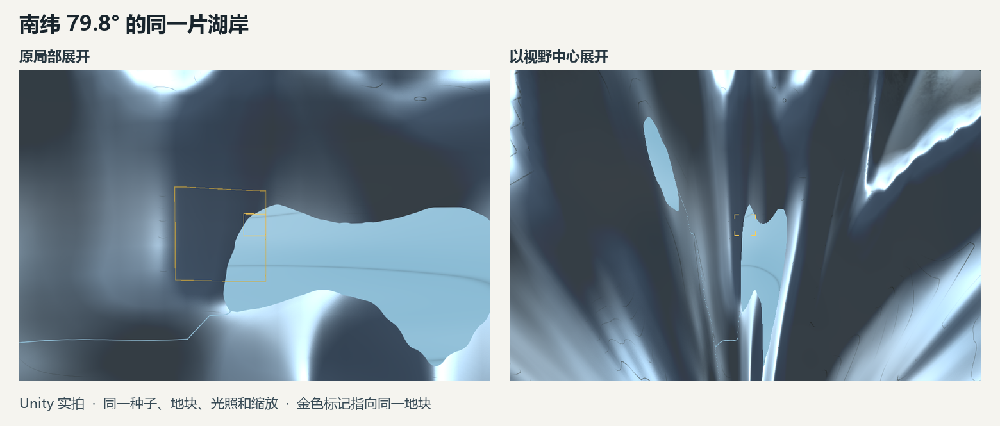
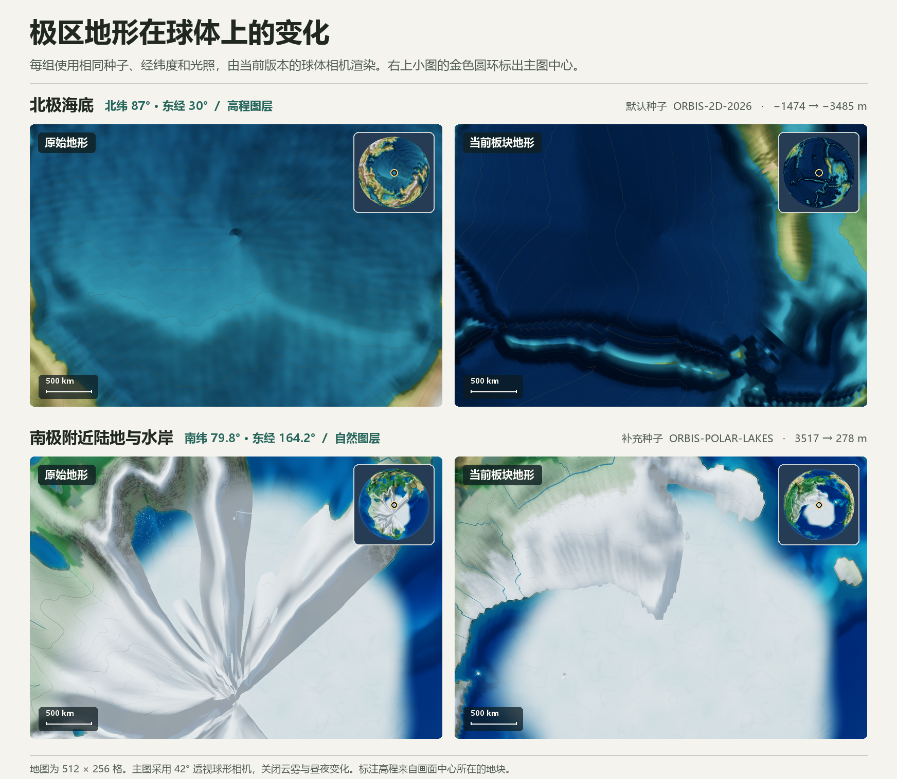
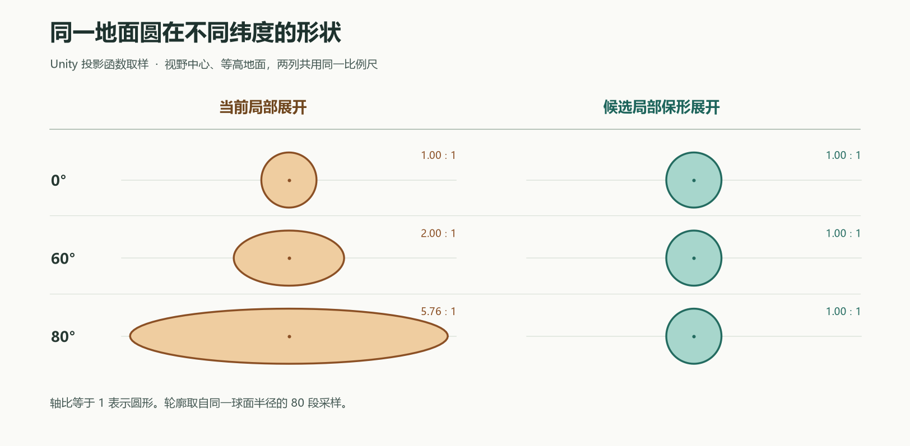

# ORBIS 高纬度地图视觉改善计划

玩家在 80° 纬度放大时，应能认出在球面上看到的同一片湖岸。圆形地物仍接近圆形，鼠标下有清楚的正方形选框，点击、造建筑和画地形命中同一块地。优先改善星球滚轮进入局部、全球战略图继续放大或按 F 查看这两条路径。气候统计图集另有全球面积判读需求。

## 已接入的版本

滚轮从球体进入以视野为中心的局部保形图。M 打开 Markley 全球战略图。即使在总览里按 F 或用滚轮进入了另一个地区，M 仍可返回第一次进入总览前的位置和比例。总览缩到全图后再向外滚一格，或按 Home，均可回到球体。在普通查看模式，四角标记选中位置，笔刷轮廓显示实际会编辑的地块。

主场景启动和「生成世界」都走 C# 板块和河谷侵蚀。旧版按格数画火山和高原，同一半径在高纬的东西向覆盖太窄。现在按大圆距离取样，地质硬度、地表扰动和坡面扩散也按地面尺度计算。极区深海保留海底起伏。地表着色器沿东西、南北相同地面距离采样高差，用于山坡和海床明暗。已有存档直接读回保存的高程和河道，可用新的地表明暗、拾取和视图控制。新世界采用新的地形生成。

项目附带的 World Atlas 高程底图另有导出和读取路径。导出时根据实际板块边界到各地块的球面距离计算洋壳年龄、海岭、海沟和陆架，按等地面范围平滑山坡与河谷。在默认种子的 512×256 底图中，98.59% 的格子保留原海陆类别。C# 读取底图后仍执行一次河流侵蚀。

| 测量对象 | 修改前 | 修改后 |
|---|---:|---:|
| 板块生成器同一座校准火山，约 81° 纬度，日期线两侧及跨极取样 | 等地面距离的东西向侧坡被截为 0，南北向约 638 m | 各方向符合相同的大圆距离侧坡公式，容差 0.5% |
| 四种板块预设，南纬 / 北纬 75–85° 海床等距离高差的东西／南北比 | 0.69 / 0.69 | 0.80 / 0.86 |
| World Atlas 导出底图，北纬 / 南纬 88–90° 海床等距离高差的东西／南北比 | 2.60 / 1.75 | 0.99 / 0.54 |
| Unity 中南北纬 79.8° 的等坡度校准地形，陆地 / 海床转动光源后的明暗响应比 | 1.223 / 1.246 | 0.995 / 0.996 |

板块预设以 `0859b41` 为对照，覆盖 8 个种子、4 种预设和 256×128 网格。改变极洋海盆方向的参数取原过渡带的半宽 10.8°，方位由种子决定。这是生成器的地形设定。四类预设的全球陆地面积分别为 30.9%、14.3%、34.0%、42.1%。75–85° 纬带内，各预设的陆地面积占比由 0.5–8.7% 变为 7.2–21.9%，局部海岸可以移动。32 个新世界中，南、北高纬陆地等距高差比分别为 0.66、0.78。

World Atlas 数据按 78 km 地面步长测量导入前的海床。最靠近北极的纬圈高度极差由 335 m 降至 57 m，南极由 228 m 降至 37 m。比值 1 表示两个方向的平均变化相当。南极测区有一条具方向性的洋脊。校准地形另以圆形作用范围和已知坡度检验方向误差。

Unity 6000.0.55f1、D3D11、RTX 5070 Laptop GPU 实测，局部图在南北纬 80° 的平地校准圆长短轴比约 1.0000001，操作角标为 46×46 像素。战略图滚轮进入与退出局部视图的抽测定位误差均小于 0.002 像素。原始位置书签、键盘焦点和滚轮反向均有独立回归。第 5 节的等面积气候专题图仍是后续设计。

同一份 512×256 存档、北纬 80°、1920×1080 的滚轮往返，预热一轮后回放三轮，每轮 120 帧。合并 360 帧，导航和相机提交的 CPU P95 由 1.38 ms 降至 0.90 ms，地表相机的 D3D11 GPU 时间戳 P95 由 6.65 ms 增至 7.01 ms。对照为 `6b1cd27`。两版均关闭云和昼夜，计时只覆盖地表视图。Mono 分配计数器未通过已知分配校准，因此这组回放没有可报告的逐帧分配数据。

主场景 Play 模式完成 12 项检查，涵盖大气纹理实际发布、战略图和局部视图往返、键盘焦点、极地素材、导航、动物、云层、地形着色、海岸、河道及实景抓图。滚轮从战略图进入局部时，光标锚点偏移 0.0015 px，返回战略图时为 0.0006 px。后台生成新世界期间另做了实际按键事件验证。默认种子和另一测试种子均能在同一帧内从原世界开总览、按 M 回球体。原先的侧栏焦点、按住 M 连发以及输入种子的情形均有检验。

独立核心测试通过 1,833,422 项断言，局部投影通过 163,123 项。另有 16 组专项通过，覆盖板块、极区地形、气候、水文和生态。读取一份 v1、一份 v2 及两份 v3 存档后，其规范保存内容在统计与读写往返中逐字节相同。整套 Play 检查结束时 Unity 报告了 6 项持久分配，原提交 `6b1cd27` 的可比退出流程也报告了 6 项。另一轮连续点击两次「生成」并拍摄实景，退出时报告了 2 项。编辑器均以 0 退出，分配的具体来源仍待定位。

两列均由当前球体相机渲染。左列读取 `6b1cd27` 的高程，右列读取主场景实际生成的地形。上排用默认种子的北纬 87° 海底，下排用补充种子南纬 79.8° 的同一陆地点。南北纬 80° 的测地圆在视野中心的短长轴比为 0.9999999，在整球视图中从中心向球缘偏移 50° 后为 0.4041。两种位置的差异来自透视。512×256 世界上的个别海沟仍可见折线边缘。

以下分析及实施清单记录试用前的基线和计划。

## 当前画面为什么会变形

基线为 `05935d2`、Unity 6000.0.55f1、`Orbis2DWorld`。本轮检查了现行 C#、着色器与既有导航回归，并在已打开的 Unity 中调用项目自己的投影函数。没有移动游戏摄像机。

| 视野中心纬度 | 当前局部图，地面小圆长短轴比 | 候选局部保形投影，地面小圆长短轴比 |
|---|---:|---:|
| 0° | 1.00 | 1.00 |
| 45° | 1.41 | 1.00 |
| 60° | 2.00 | 1.00 |
| 75° | 3.86 | 1.00 |
| 80°，南北相同 | 5.76 | 1.00 |
| 85°N | 11.47 | 1.00 |

**局部图有两个不同的「方」。** 在现有经纬网格中，同样一格经度的东西地面宽度随纬度乘上 cos φ，一格纬度的南北长度基本恒定。当前局部展开把相同角度的经纬步长画成相同宽高，所以地址格和 4×4 区域框在平地上方正，真实地貌却沿东西方向放大约 1/cos φ。反过来，按地面比例显示时，高纬真实地块边界自然偏窄。这也解释了为什么上一版修好选框后，湖岸和地形仍可能看着别扭。

**全球战略图有另一种误差。** 它已经使用 Markley 投影。本轮在每个表列纬度取六个经度，在这些样点测得长短轴比最大约 1.0004。不同位置的整体放大率仍会变化，四面体顶点及拼接处也需单独验收。优先改善从总览进入细看的交接和叠加图层。

**新气候图集显示的是经纬矩形。** 它把 64×32 个样点铺满 2∶1 的窗口。以北纬 60° 以上为例，这一带占整幅经纬图的 **16.7%**，实际只占整个球面的 **6.7%**。读图时会高估极地气候带的覆盖面积。右下角小地图也使用经纬底图，主要承担定位和显示视野范围。

测量采用球面东西、南北方向各 ±0.0005 弧度的对称扰动，由二维投影导数的两个奇异值计算长短轴比。六个经度为 −150°、−100°、−40°、15°、70°、130°。图中轮廓另由同一半径的 80 段测地圆采样绘制。两者均为**平地投影测量**。游戏成像还包括地形高度、视差和像素素材。现有 `Validation/LocalPlanet` 的 **72,945 项几何检查已通过**，其中同时包含方地址格和候选保形函数的测试。

## 实施顺序

### 1. 建立同地对照

- [ ] 在现有导航回归中加入等地面距离的小圆、十字及斜向线段。分别在赤道、南北纬 60°、80°、85°、接近极点和跨日期线的位置，从两条路径拍摄视野中心与四周。每次记录种子、地理位置、相机比例、展开进度和视差设置。
- [ ] 再选一段弯河、一片湖岸及一处有树的山坡，用同一个世界、选区和光照作对照。先用平地测数学误差，再用高程实景检查岸线和点击。狭长湖泊本身可以是正确的地理特征。
- [ ] 将现有「地理地址格方正」用例归入地址图检查。为玩家使用的局部图另外记录地貌长短轴、操作选框宽高、真实地块命中、屏幕定位误差四项指标。

### 2. 先交付能操作的局部图

- [ ] 复用 `PlanetLocalProjection.StereographicLog/Exp`，让摄像机当前所看地理位置成为局部投影中心。局部地面在各方向采用相同比例。视野边缘仍有大小变化，例如距中心 25° 时，球极平面投影的局部长度比例约为中心的 1.049 倍，可据此限制细看范围。
- [ ] 让 CPU 导航、地表顶点和片元、深度、路径投影及拾取共用同一球面方向。删换局部端点现有经纬直加的快捷分支时，一起更新着色器取样、滚轮锚点和地形视差逆算。地理 UV 继续读取原有 Tile、河道、文明与存档。
- [ ] 同次交付方形操作标记。普通查看时在命中地块中心显示屏幕正方形四角标，线宽随像素密度稳定。地形笔刷展开或选择 4×4 区域时，另用细轮廓或半透明填色标明**实际会受影响的地块**。角标对应选中位置，轮廓对应编辑范围。极细的真实地块可以减淡边线，点击仍用原始地图地址。

局部过渡可用同方位的径向插值。令 s 为图面半径除以星球半径，t 为展开权重，取球心角 **c = (1−t)s + 2t·atan(s/2)**。起点对应现有测地展开，终点对应局部保形展开。在可见圆盘内它沿半径单调，中间帧的反算可做有界一维求解。先在低开销测试中与渲染结果逐点对照，再替换现有多起点逆算。

### 3. 接通全球战略图与极区操作

- [ ] 战略总览继续用 Markley。按 F 聚焦和滚轮进入近景时，转到第 2 步的同一局部视图。用球面坐标传递关注点，按关注点附近「相同地面距离对应多少屏幕像素」匹配比例，并平滑转到北向上。M 主动打开的总览记录进入位置和比例，便于原路返回。
- [ ] 使用分开的进入与退出阈值，避免滚轮反向时来回切图。普通星球入口先对准视野中心，局部连续缩放锁住光标下的地面，拖动只改变位置。退出时用**最后看到的地理位置**恢复球面视角，再恢复自由转动。
- [ ] 真北在极点本身没有唯一方向。大多数地区让地图中心的北方朝上，穿越极点的短程沿用上一帧方向并在球面上平行移动，离开极区后平滑对齐地理北。跨日期线使用离当前视图最近的经度副本。小地图视野框跟随同一实际画面投影。

### 4. 对齐河湖、植被和地形细节

- [ ] 地形纹理、波纹和河道宽度按球面地面距离采样，河流沿既有流向和流量画。对照现有河宽、浅滩和浪花的纬度补偿，逐处校核一次换算是否已经完成。开启和关闭地形视差各比一次岸线与河心线。
- [ ] 树木、建筑和动物的根部继续固定在真实地理位置。像素素材用当地投影的东西、南北屏幕方向摆放，保留原画的俯视长宽与风摆。当前 `FlatArtworkLatitudeScale` 会随展开趋向 1，动物定位也含针对旧经纬图的过极翻转，两处需随新投影校正。
- [ ] 依据屏幕像素覆盖率淡入淡出细格、选区线和细纹，并检查极地、日期线的纹理导数。缩放期间复用现有地形网格和缓存。只有在相同地貌的对照仍显示源数据方向偏差时，再单独调查地形生成和河道数据。

### 5. 给气候图集使用等面积底图

- [ ] 全球气候专题图采用 Equal Earth 等面积投影，使苔原、沙漠和降水带的可见范围更接近实际面积。这项可独立交付。为每个输出像素缓存反投影地理坐标，仍读原 64×32 样点，分类用离散颜色显示。更细的输出轮廓只改善投影边缘。
- [ ] 用相同的正反投影更新地块标记和点击定位，忽略图廓外的点击。重复选择同一地块时，气候值、区域均值、协方差和异常评分应逐项相同。
- [ ] 小地图继续显示经纬定位和可点击视野框。分别验证普通局部视图、Markley 和跨极、跨日期线的轮廓。若视野经过图幅边缘，分段绘制以避免一条横线贯穿整图。

## 验收与交付

下列是实施后的目标。首轮先交付「80° 湖岸 + 正方形选框 + 点击准确」的前后对照，再铺开其他图层。

| 验收对象 | 建议通过条件 |
|---|---|
| 高频使用的局部近景 | 在平坦校准地面上，视野中央 70% 区域的等地面距离小圆长短轴比 ≤1.03。长短轴按成像轮廓拟合，放大后使用半径至少 32 像素的样本。视野边缘另记比例变化 |
| 选框与编辑 | 单格操作角标宽高差 ≤1 屏幕像素。抽测真实地块内部及边线两侧，包括 4×4 编辑与日期线，两侧命中正确的 Tile/Zone。保留现有 CPU 拾取与 GPU 地形定位差 <0.20 像素的回归 |
| 缩放与拖动 | 同一套中心和偏心滚轮、快速反向、长拖及往返脚本覆盖两条入口。现有适用的偏心锚点 <0.05 像素测试继续通过。新增跨视图交接处锚点偏移 ≤1 像素。穿极不发生单帧 180° 翻转，回到星球后两个拖动轴都有效 |
| 地形视差与素材 | 平地、山坡各留同址画面。确认岸线不裂、河岸对齐、树根与建筑落点稳定、树冠长宽与原画一致。坡面允许表现真实坡度，按锚点及轮廓连续性验收 |
| 气候专题图 | 用合成纬带检查显示面积。北纬 60° 以上在有效图廓内的像素面积应占约 6.7%，建议允许 ±0.5 个百分点。另测经度接缝和两极附近的点击与标记往返 |
| 性能与兼容性 | 固定同一世界、质量、分辨率和滚轮输入，在 1080p 至少重复三轮，分别记录 CPU/GPU 帧时间第 95 百分位及托管分配。建议两者各自的 P95 增量 ≤1 ms，稳态导航零新增逐帧托管分配。暂停世界时对比改前改后的存档字节与同地点编辑命中 |

## 代码入口

| 工作 | 主要文件 |
|---|---|
| 投影、锚点、摄像机及路径 | `Assets/ORBIS/Runtime/Planet/Core/PlanetLocalProjection.cs`、`Assets/ORBIS/Runtime/FlatWorld/Presentation/FlatScrollNavigator.cs` |
| 局部地表、深度与材质取样 | `Assets/ORBIS/Resources/ORBIS/GeographicCoordinates.cginc`、`Assets/ORBIS/Resources/ORBIS/FlatWorld/LocalProjection.cginc`、`LocalSurface.shader` |
| 选区、网格与物件 | 同一资源目录下的 `FlatMapFragment.cginc`、`FlatSurfaceField.cginc`、`FlatPixelDetail.cginc`，以及 `Presentation/FlatGlobeGeometry.cs` |
| 战略图、小地图与水体 | `Presentation/MarkleyAtlasNavigator.cs`、`Presentation/FlatMinimapProjection.cs`、`FlatWorld/Water/FlatRiverOptics.cginc` 和 `FlatWater.cginc` |
| 全球专题图与定位 | `Presentation/FlatClimateStatisticsPanel.cs`、`Presentation/FlatWorldMinimap.cs`、`FlatWorld.uxml` 和 `FlatWorld.uss` |
| 回归与屏幕探针 | `Validation/LocalPlanet/Program.cs`、`Assets/ORBIS/Editor/LocalNavigationRegression.cs`、`PolarDetailRegression.cs`、`PolarDetailProbe.shader` |
