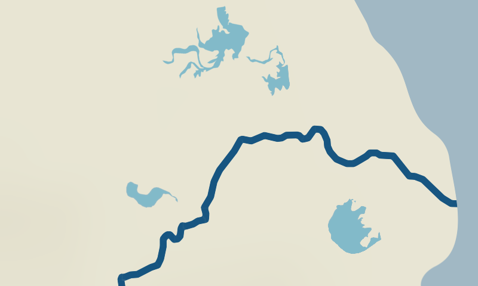
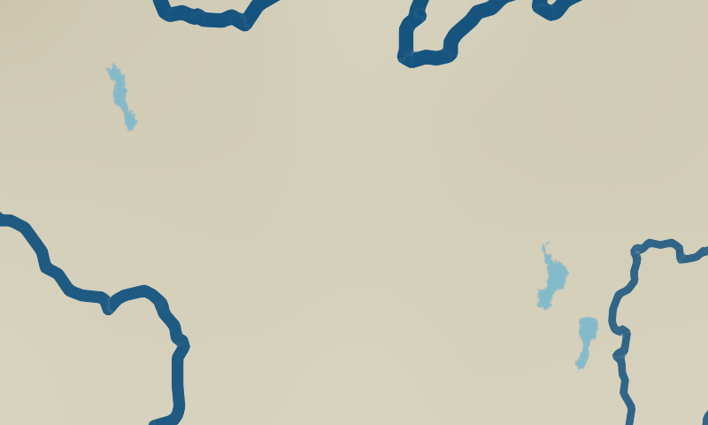

# EU4 湖泊与 ORBIS 地球预设

EU4 1.37 的 3,925 条有效省份记录中，有 **84 个省份的地形为 Lake**。下表列出全部 84 个 ID。统计取自 PDX Tools 的 1.37 游戏数据，其编译器读取原版 `map/default.map` 的 `lakes`。这 84 个 ID 与 EU4 1.31 地理省份表的湖泊分类逐项一致，也都能在标记为 1.37.5 的 Strategy Atlas 底图中找到。一个 ID 可以代表湖群、河段，甚至一片海域。[1.37 数据](https://pdx.tools/assets/data-C77CEKNp.bin) · [数据编译器](https://github.com/pdx-tools/pdx-tools/blob/ac3b593ac6f3b084adc89e96284b9a40bc645953/src/pdx-assets/src/eu4/compiler.rs#L409-L456) · [省份表](https://www.eu4cn.com/wiki/Geographical_list_of_provinces) · [1.37.5 交互地图](https://strategy-atlas.com/eu4/)

**粗体**标出 ORBIS 在全球面积门槛之外补充岸线的 15 个 EU4 地标。下方另列地球预设重点核对的中国湖泊。省份号用于查对游戏，湖岸和坐标来自地理资料。

| 地区 | EU4 湖泊类省份 ID 与对应地名 |
| --- | --- |
| 瑞典 | 1250 维纳恩湖、**1251 韦特恩湖**、1886 Storavan、1887 Storsjön、**1977 梅拉伦湖**、2953 耶尔马伦湖 |
| 芬兰 | 1883 西部湖群、1884 东部湖群、1885 中部湖群、**4139 奥卢湖**、4140 塞马湖 |
| 东欧与波罗的海 | **1260 楚德湖**（含南部普斯科夫湖）、1261 拉多加湖、1262 奥涅加湖、4235 维斯瓦潟湖 |
| 中欧与阿尔卑斯山地 | **1325 巴拉顿湖**、**1889 日内瓦湖**、**1890 博登湖** |
| 里海、中亚与西亚 | 1326 里海、1327 咸海、1653 巴尔喀什湖、**1891 图兹湖**、1892 凡湖、1893 乌尔米耶湖、**1894 塞凡湖**、**1976 死海**、4136 斋桑湖、4137 阿拉湖、4138 伊塞克湖 |
| 西伯利亚、东亚与东南亚 | 1654 贝加尔湖、1655 鄱阳湖、1895 太湖、1896 洪泽湖、**1897 洞庭湖**、1898 洞里萨湖、2000 青海湖、**2001 色林错** |
| 非洲 | **1648 乍得湖**、1649 维多利亚湖、1650 坦噶尼喀湖、1651 马拉维湖、1899 塔纳湖、1900 图尔卡纳湖、2471 杰里德盐湖、4132 姆韦鲁湖、4133 基伍湖、4134 爱德华湖（Rutanzige）、4135 艾伯特湖 |
| 北美五大湖及周边 | 1659 安大略湖、1660 伊利湖、1661 休伦湖、1662 密歇根湖、1663 苏必利尔湖、1664 尼皮贡湖、**1903 尚普兰湖** |
| 加拿大中西部与北部 | 1665 温尼伯湖、1911 Island Lake、1912 驯鹿湖、1913 伍拉斯顿湖、1914 大奴湖、1915 阿萨巴斯卡湖、1916 杜邦特湖、1917 Yathkyed、1918 Kasba、1919 Nueltin、1920 Wholdaia、1921 Peter Pond、1923 威利斯顿湖 |
| 加拿大东部 | 1904 圣让湖、1905 马尼夸根湖、1906 Michikamau、1907 Bienville、1908 Clearwater 湖群、1909 Minto、1910 拉格朗德河 |
| 美国其他地区 | **1658 奥基乔比湖**、1922 大盐湖、4940 图莱里湖、4941 卡维拉湖 |
| 中南美洲 | 1657 尼加拉瓜湖、1656 的的喀喀湖、1902 波波湖 |
| 澳大利亚 | 4870 威兰德拉湖群 |
| 北冰洋 | 1888 喀拉海 |

## 中国湖泊

EU4 把鄱阳湖、太湖、洪泽湖、洞庭湖、青海湖和色林错单列为湖泊省份。ORBIS 地球预设按真实地理选取了以下 **25 个重点湖泊**，其中包括完整的五大淡水湖，以及跨境的兴凯湖和贝尔湖。

| 地区 | 已校验的湖泊 |
| --- | --- |
| 长江及淮河流域 | 鄱阳湖、洞庭湖、太湖、洪泽湖、巢湖、高邮湖、洪湖、梁子湖 |
| 东北与内蒙古 | 兴凯湖、呼伦湖、贝尔湖、查干湖 |
| 青藏高原 | 青海湖、色林错、纳木错、羊卓雍错、扎陵湖、鄂陵湖、玛旁雍错 |
| 新疆 | 博斯腾湖、赛里木湖、艾比湖 |
| 云南 | 滇池、洱海、抚仙湖 |

滇池、洱海、抚仙湖和赛里木湖取自 HydroLAKES v1.0。洞庭湖的主湖区和东洞庭湖分别保留资料中的轮廓。鄱阳湖等季节性湖泊显示资料所记录的水面，随月份伸缩的淹没边界还需要分期岸线资料。[HydroLAKES 数据与署名](https://www.hydrosheds.org/products/hydrolakes) · [Natural Earth 湖泊](https://github.com/nvkelso/natural-earth-vector/blob/v5.1.2/geojson/ne_10m_lakes.geojson)

| 江淮与长江口 | 滇中与滇西 |
| --- | --- |
|  |  |
| 长江从左下方向东入海。巢湖在左下方，太湖在右下方，洪泽湖与高邮湖在北面。 | 左上是洱海。右下的两片湖面从北到南依次是滇池和抚仙湖，中间保留陆地。 |

两图均来自 Unity 中的「河网」图层。长江镇江以下取 Natural Earth 的潮汐水域边界，从两岸之间追踪主水道，绕过崇明岛接至长江口。该线用于地图表达，江水流量继续由模拟计算。

## 在 ORBIS 地图上怎么看

在 **世界 → 生成新世界 → 地球（真实地形）** 生成地图，将图层切换为 **河网**。全球面积门槛为每个水域多边形扣除岛屿后的球面面积 **2,000 平方公里**。苏必利尔湖、贝加尔湖和维多利亚湖等自动入选。另为 15 个 EU4 地标补入 17 个多边形，为中国湖泊补入 13 个 Natural Earth 轮廓和 4 个 HydroLAKES 轮廓。全球共计 132 个源多边形，沿共边合并为 126 个水域轮廓，保留 198 个岛屿内环。一个有名的湖可能由几个多边形组成。[Natural Earth 湖泊](https://github.com/nvkelso/natural-earth-vector/blob/v5.1.2/geojson/ne_10m_lakes.geojson) · [HydroLAKES](https://www.hydrosheds.org/products/hydrolakes)

- **看高纬形状。** 可定位北纬 74.55°、东经 101.60° 的泰梅尔湖。岸距按球面弧长计算，球体、战略图与局部展开共用岸线。泰梅尔湖与加拿大大熊湖依面积入选，均在 EU4 的 84 个 ID 之外。
- **看岛屿和细长湖。** 北纬 45.80°、西经 82.33° 是休伦湖的马尼图林岛。北纬 47.00°、东经 18.08° 位于巴拉顿湖东部。远景使用 8192 × 4096 的岸距图，近景沿湖岸读取细化 8 倍的分块，南北采样间距从约 4.9 公里缩至约 610 米。岸线保留的地理细节取决于原始 1:1,000 万矢量资料。
- **看历史水域。** 咸海采用 Natural Earth 此版本的分盆岸线，乍得湖采用该版收录的南部水面。EU4 的芬兰湖群按地球资料中的各片水域绘制。喀拉海由海洋资料处理。图莱里湖、卡维拉湖、威兰德拉湖群保留在历史参考清单中。[威兰德拉湖区](https://whc.unesco.org/en/list/167/) · [Natural Earth 地理资料](https://www.naturalearthdata.com/downloads/10m-physical-vectors/10m-lakes/)
- **看模拟水体。** 新地球预设以湖面覆盖过半的格子补入这四座湖的实测轮廓。2048 列地图为滇池补入 1 格、赛里木湖 2 格，洱海和抚仙湖主要通过近景岸线显示。4096 列地图为滇池补入 3 格、洱海 3 格、抚仙湖 2 格、赛里木湖 7 格。建造和寻路依照当前世界的水体格。随机世界沿自身地形生成河湖。

## 巴拉顿湖的岸线对照

在 Unity 运行地球预设，用同一视角截取 800 × 480 像素的「河网」图层。看湖面中部的两个狭窄处，可以辨认出细化前后的差别。

| 仅使用全球岸线 | 启用局部岸线细化 |
| --- | --- |
|  |  |
| 3 片可见水面，与参考轮廓重合度 82.0% | 1 片连续水面，与参考轮廓重合度 97.7% |

重合度取渲染水面和 Natural Earth 湖泊多边形的交集像素数除以并集像素数。两张图均以归一化 RGB 的蓝色分量减红色分量大于 0.09 判为水面，按共边像素计算连通区域。
