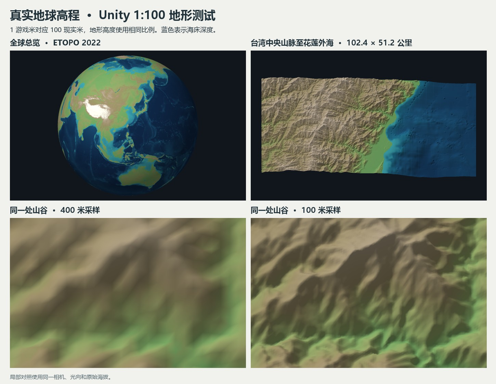

# 1:100 真实地球地形测试图

在 Unity 打开 **Tools → ORBIS → 1:100 Earth Terrain**。首次打开会读取本目录的地图。选择 **局部 100 米**，点击 **定位最高点**，然后切换 **局部 400 米**，即可在同一机位比较山脊和沟谷。局部视图中左键拖动平移，右键拖动改变视角，滚轮缩放。切回 **地球** 可看全球位置，小圆圈标出当前样区中心。



## 比例与覆盖

水平距离和高程采用相同比例。**100 现实米 = 1 游戏米**。蓝色表示海床深度，便于直接观察海岸以下的起伏。

| 地图 | 覆盖与采样 | 在 Unity 中的尺寸 |
| --- | --- | --- |
| 地球概览 | 全球 4320 × 2160，每格 5 角分，赤道约 9.28 公里。全球球面用 16 位高程纹理表现地形细节。 | 平均半径 63,710.088 游戏米 |
| 台湾中央山脉至花莲外海 | 102.4 × 51.2 现实公里，1025 × 513 个顶点，100 米投影网格，含全部边界 | 1024 × 512 游戏米，1 格 = 1 × 1 游戏米，高程 −41.31 至 +36.44 游戏米 |
| 游戏内全球高度图 | 1024 × 512，与现有世界模拟的高度图格式兼容 | 使用现有游戏场景的尺寸，导入范围为 −4000 至 +4000 现实米 |

台湾样区使用台湾当地的 UTM 51N 米制坐标。样区四角的投影比例偏差小于 0.03%。陆地来自 Copernicus GLO-30 地表模型，数据包含植被和建筑对表面高度的影响。海床来自 ETOPO 2022，当地源数据间距约 420 × 460 米。海岸与海床都铺在 100 米网格上，可辨认的海底细节仍受源数据限制。全球概览和台湾样区已经随仓库提供，可离线打开。

## 在实际游戏测试全球地图

1. 运行 `Assets/ORBIS/Scenes/Orbis2DWorld.unity`，进入 **文件 → 高度图导入 / 导出**。
2. 在文件路径中填入本目录下 `global/earth-legacy-1024.png` 的绝对路径，勾选 **按米保留原图高程**，点击 **导入**。导入会建立新世界，游戏会据此计算气候、排水和初始文明。
3. 按米模式可比较山地和低地的连续变化。默认模式仍使用地形编辑器的高度档。受 PNG 高程范围限制，游戏版全球图的深海和极高山会截断；编辑器测试图的原始有符号高程保存在两个 `.i16` 文件中。

## 更换测试地区

从仓库根目录执行以下命令，可以为指定经纬度生成可直接打开的独立地图包。首次生成需要联网获取数据，下载的原始图幅会缓存到用户目录。示例以花莲为中心，生成 25.6 × 25.6 现实公里的区域。

```powershell
python -m pip install -r Tools/EarthScale100/requirements.txt
python Tools/EarthScale100/generate_patch.py --center-lon 121.61 --center-lat 23.968 --columns 257 --rows 257 --name 花莲 --package ValidationOutput/Earth-Hualien
```

在地球测试窗口点击 **选择数据目录**，打开刚生成的 `ValidationOutput/Earth-Hualien`。每条边有 N 个顶点、N−1 个格子；一个新包最多支持 4,194,304 个局部顶点。需要拼接相邻区域时，使用相同的米制 `--epsg` 投影。只想看全球 15 角秒高程源时，可以加 `--etopo-only`。请为新包指定尚未使用的输出目录。

## 精度对照

在 100 米网格和从相同数据抽取的 400 米网格上对比三角形地表，采用同一光照和相机。台湾样区的最高采样点从 3554 米提高到 3644 米。在 326,632 个 GLO-30 正高程陆地点上，两种网格的高程差均方根为 46.35 米，绝对差的第 95 百分位为 97.75 米。这些数值衡量加密网格带来的变化，实地测量精度取决于原始高程数据。

可从仓库根目录运行 `python Validation/EarthScale100/verify_reference.py` 复查数据哈希、台湾山地和海床控制点及上述对照数值。需要 Python 3.11 或更新版本及 NumPy。

## 数据来源

全球概览采用 NOAA ETOPO 2022 60 角秒冰面版，降采样时按像元范围取平均。原始来源、坐标定义、源文件与结果文件的 SHA-256 均随图提供。[全球元数据](global/metadata.json) · [NOAA ETOPO 2022](https://doi.org/10.25921/fd45-gt74)

台湾样区融合 Copernicus GLO-30 与 NOAA ETOPO 2022 15 角秒数据。局部元数据记录投影边界、原始图幅和逐文件哈希，`.source.u8` 逐点记录高程来源。高程基准为 EGM2008，存储精度为 1 现实米。[局部元数据](local/taiwan-100m.json) · [署名声明](NOTICE.txt) · [Copernicus DEM 许可](licenses/Copernicus-DEM.pdf)
