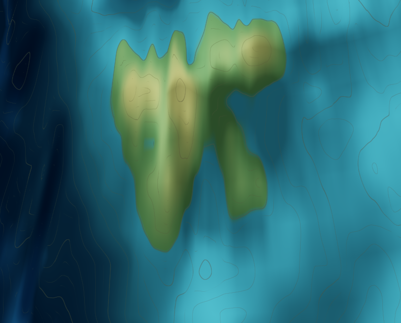
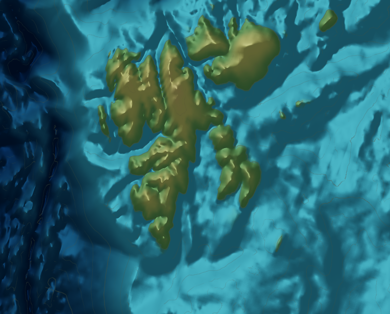
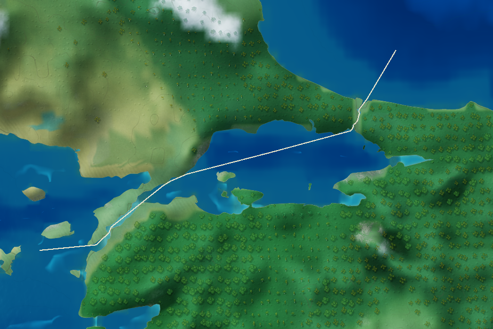

# 1:100 真实地球地形测试图

在 Unity 打开 **Tools → ORBIS → 1:100 Earth Terrain**。首次打开会读取本目录的地图。选择 **局部 100 米**，点击 **定位最高点**，然后切换 **局部 400 米**，即可在同一机位比较山脊和沟谷。局部视图中左键拖动平移，右键拖动改变视角，滚轮缩放。切回 **地球** 可看全球位置，小圆圈标出当前样区中心。


## 比例与覆盖

水平距离和高程采用相同比例。**100 现实米 = 1 游戏米**。蓝色表示海床深度，便于直接观察海岸以下的起伏。

| 地图 | 覆盖与采样 | 在 Unity 中的尺寸 |
| --- | --- | --- |
| 地球概览 | 全球 4320 × 2160，每格 5 角分，赤道约 9.28 公里。全球球面用 16 位高程纹理表现地形细节。 | 平均半径 63,710.088 游戏米 |
| 台湾中央山脉至花莲外海 | 102.4 × 51.2 现实公里，1025 × 513 个顶点，100 米投影网格，含全部边界 | 1024 × 512 游戏米，1 格 = 1 × 1 游戏米，高程 −41.31 至 +36.44 游戏米 |
| 游戏内全球高度图 | 1024 × 512，与现有世界模拟的高度图格式兼容 | 使用现有游戏场景的尺寸，导入范围为 −4000 至 +4000 现实米 |

台湾样区使用台湾当地的 UTM 51N 米制坐标。样区四角的投影比例偏差小于 0.03%。陆地来自 Copernicus GLO-30 地表模型，数据包含植被和建筑对表面高度的影响。海床来自 ETOPO 2022，当地源数据间距约 420 × 460 米。海岸与海床都铺在 100 米网格上，可辨认的海底细节仍受源数据限制。全球概览和台湾样区已经随仓库提供，可离线打开。

## 玩家生成地球

在游戏的 **世界 → 生成新世界 → 地形** 中选择 **地球（真实地形）**，选好大小和种子，点击 **生成世界**。地球、大陆与群山、群岛、超级大陆和内海世界都能用以下六档尺寸离线开局。每一格都有独立高程、水体、气候和归属。每 4 × 4 格组成一个文明管理区。

| 地图尺寸 | 可玩格数 | 每格南北距离、赤道东西距离 |
| --- | ---: | ---: |
| 256 × 128 | 32,768 | 约 156.37 公里 |
| 512 × 256（默认） | 131,072 | 约 78.18 公里 |
| 1024 × 512 | 524,288 | 约 39.09 公里 |
| 1536 × 768 | 1,179,648 | 约 26.06 公里 |
| 2048 × 1024 | 2,097,152 | 约 19.55 公里 |
| 4096 × 2048 | 8,388,608 | 约 9.77 公里 |

表中的距离按地球平均半径 6371.0088 公里计算。纬度升高时，同一格的东西宽度按纬度余弦缩小。视窗比例尺按当前镜头下两端对应的球面距离更新。

4096 档在同一片地表上有 2048 档四倍的可玩格，共 524,288 个文明管理区。逐格保存高程、水体和十二个月的气候后，一份完整原生存档约占 1.02 GiB。

球体和局部视图在南北纬 45° 到 60° 之间逐渐叠加 ETOPO 观测高程，从南北纬 60° 到极点使用完整细节。南北极各用一张 1537 × 1537 的立体投影图，山脊、等高线和海床按当地地面距离着色。源数据是 5 角分概览。海岸采用 Natural Earth 轮廓，主要湖岸结合 Natural Earth 和 HydroLAKES，内陆湖泊使用模拟水位。玩家修改高程后，笔刷覆盖区和紧邻地块按游戏地形显示。

在图层中选择 **河网** 可以查看地球的主要河道、湖泊和入海口。中国五大淡水湖、青藏高原和东北的大湖均有地理岸线，云南三湖与赛里木湖采用 HydroLAKES v1.0。随机世界在同一图层显示自己的排水网络。导出高度图时另附透明河网 PNG。[中国 25 个重点湖泊、实机图与 EU4 名单](EU4-Lakes.md#中国湖泊)

下图均为游戏中 512 × 256 地球预设的高程视图。镜头位于斯瓦尔巴群岛北纬 78.1°、东经 19°，两次使用相同缩放。

| 原经纬网格插值 | 极区观测地形 |
| --- | --- |
|  |  |

运行 `python Tools/EarthScale100/bake_polar_relief.py --check` 可复核极区资源。这个命令读取仓库内的 ETOPO 高程，并使用固定版本的 Natural Earth v5.1.2 海岸矢量。首次烘焙会下载和校验海岸矢量，游戏运行时使用随包资源。[Natural Earth 海岸数据](https://github.com/nvkelso/natural-earth-vector/tree/v5.1.2/geojson)

右下角的小地图采用 Hammer 等面积投影。不同纬度相同地表面积的地区占用相同图面面积。小地图上的视野线、准星和点击定位都使用同一投影，点击定位会保留当前缩放。

每档地球高程都从 4320 × 2160 的 ETOPO 全球概览按格子覆盖范围取平均，保留到整数米。4096 档的格均高程范围为 −10,161 至 +6,332 米。Natural Earth 海岸和内陆湖泊资料为海峡连通和湖面提供参考，游戏在此基础上计算排水、径流与气候。更换种子可以在相同的真实地形上重新开局。读档会还原地形预设、地图尺寸与模拟数据。可用 `python Tools/EarthScale100/bake_player_presets.py --check` 核对随包高程。

新生成的地球为 18 条海峡保留连续的海水格，包括博斯普鲁斯、达达尼尔、琼州、台湾、直布罗陀和新加坡海峡。烘焙时沿 Natural Earth 海洋多边形寻找相邻格之间的水面开口，仅调整维持通道所需的格子。如果陆岸把格均高程抬到海面以上，游戏用海面下 1 米代表尚未解析的水深。局部镜头按地理岸线绘制两岸。V5 地球存档使用这套地形基准，之前的地球存档继续使用各自保存时的基准。可用 `python Tools/EarthScale100/bake_player_water.py --check` 复核六档水体数据。

在北纬 41.11°、东经 29.07° 放大可查看博斯普鲁斯海峡的两岸。重点海峡的近景岸线采用南北约 217 米间距的独立采样。地形编辑、排水和格子选择仍使用上表中的模拟分辨率。

在 **操作 → 海上航线（选择两处海面）** 中依次点击出发海面和目的海面。可以从爱琴海（东经 25.65°、北纬 40.00°）选到黑海（东经 29.48°、北纬 41.64°），查看经过达达尼尔和博斯普鲁斯的航线。再次点击可规划下一条，右键可清除。海洋寻路也支持随机世界，地形笔刷重算后会采用新的通行条件。



船只逻辑可为当前世界创建 `var planner = new FlatSeaNavigation(world, survey)`，再调用 `planner.Find(start, end, cancellationToken)`。返回的 `FlatSeaPoint[]` 按航行顺序排列，经纬度单位为度。两点之间无法通行时返回空数组。新地球地图的 `survey` 由 `FlatStraitNavigation.Read` 从 `EarthStraitShore.bytes` 解码，可跨查询复用。随机世界可以直接使用 `new FlatSeaNavigation(world)`。地形编辑或换图发布新世界后，用新的世界数据创建规划器。

运行 `python Validation/EarthScale100/verify_strait_shore.py --navigation` 可在全部六档地图上规划样例航线，并逐段对照 Natural Earth 海洋多边形。`--navigation 4096` 可只测最大地图。

16 位高度图 PNG 继续用 −4000 至 +4000 米编码，在范围以外的高山与海床会在导出时取边界值。游戏的原生存档可以保存完整高程。测试 PNG 导入时，进入 **存档 → 高度图导入 / 导出**，填入 `global/earth-legacy-1024.png` 的绝对路径，勾选 **按米保留原图高程**，再点击 **导入**。100 米局部样区可在上方的 Unity 测试窗口查看。

## 更换测试地区

从仓库根目录执行以下命令，可以为指定经纬度生成可直接打开的独立地图包。首次生成需要联网获取数据，下载的原始图幅会缓存到用户目录。示例以花莲为中心，生成 25.6 × 25.6 现实公里的区域。

```powershell
python -m pip install -r Tools/EarthScale100/requirements.txt
python Tools/EarthScale100/generate_patch.py --center-lon 121.61 --center-lat 23.968 --columns 257 --rows 257 --name 花莲 --package ValidationOutput/Earth-Hualien
```

在地球测试窗口点击 **选择数据目录**，打开刚生成的 `ValidationOutput/Earth-Hualien`。每条边有 N 个顶点、N−1 个格子；一个新包最多支持 4,194,304 个局部顶点。需要拼接相邻区域时，使用相同的米制 `--epsg` 投影。只想看全球 15 角秒高程源时，可以加 `--etopo-only`。请为新包指定尚未使用的输出目录。

## 精度对照

在 100 米网格和从相同数据抽取的 400 米网格上对比三角形地表，采用同一光照和相机。台湾样区的最高采样点从 3554 米提高到 3644 米。在 326,632 个 GLO-30 正高程陆地点上，两种网格的高程差均方根为 46.35 米，绝对差的第 95 百分位为 97.75 米。这些数值衡量加密网格带来的变化，实地测量精度取决于原始高程数据。

可从仓库根目录运行 `python Validation/EarthScale100/verify_reference.py` 复查数据哈希、台湾山地和海床控制点及上述对照数值。需要 Python 3.11 或更新版本及 NumPy。

## 数据来源

全球概览采用 NOAA ETOPO 2022 60 角秒冰面版，降采样时按像元范围取平均。原始来源、坐标定义、源文件与结果文件的 SHA-256 均随图提供。[全球元数据](global/metadata.json) · [NOAA ETOPO 2022](https://doi.org/10.25921/fd45-gt74)

台湾样区融合 Copernicus GLO-30 与 NOAA ETOPO 2022 15 角秒数据。局部元数据记录投影边界、原始图幅和逐文件哈希，`.source.u8` 逐点记录高程来源。高程基准为 EGM2008，存储精度为 1 现实米。[局部元数据](local/taiwan-100m.json) · [署名声明](NOTICE.txt) · [Copernicus DEM 许可](licenses/Copernicus-DEM.pdf)
