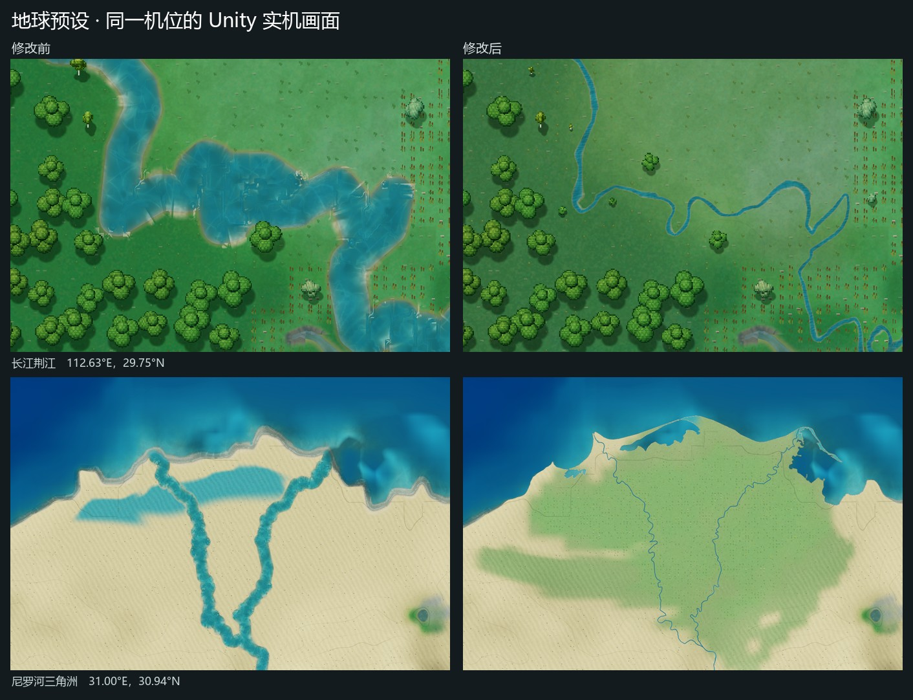

# 1:100 真实地球地形测试图

在 Unity 打开 **Tools → ORBIS → 1:100 Earth Terrain**。首次打开会读取本目录的地图。选择 **局部 100 米**，点击 **定位最高点**，然后切换 **局部 400 米**，即可在同一机位比较山脊和沟谷。局部视图中左键拖动平移，右键拖动改变视角，滚轮缩放。切回 **地球** 可看全球位置，小圆圈标出当前样区中心。


## 比例与覆盖

水平距离和高程采用相同比例。**100 现实米 = 1 游戏米**。蓝色表示海床深度，便于直接观察海岸以下的起伏。

| 地图 | 覆盖与采样 | 在 Unity 中的尺寸 |
| --- | --- | --- |
| 地球概览 | 全球 4320 × 2160，每格 5 角分，赤道约 9.28 公里。全球球面用 16 位高程纹理表现地形细节。 | 平均半径 63,710.088 游戏米 |
| 台湾中央山脉至花莲外海 | 102.4 × 51.2 现实公里，1025 × 513 个顶点，100 米投影网格，含全部边界 | 1024 × 512 游戏米，1 格 = 1 × 1 游戏米，高程 −41.31 至 +36.44 游戏米 |
| 游戏内全球高度图 | 1024 × 512，与现有世界模拟的高度图格式兼容 | 使用现有游戏场景的尺寸，导入范围为 −4000 至 +4000 现实米 |

台湾样区使用台湾当地的 UTM 51N 米制坐标。样区四角的投影比例偏差小于 0.03%。陆地来自 Copernicus GLO-30 地表模型，数据包含植被和建筑对表面高度的影响。海床来自 ETOPO 2022，当地源数据间距约 420 × 460 米。海岸与海床都铺在 100 米网格上，可辨认的海底细节仍受源数据限制。全球概览和台湾样区已经随仓库提供，可离线打开。

## 玩家生成地球

在游戏的 **世界 → 生成新世界 → 地形** 中选择 **地球（真实地形）**，选好大小和种子，点击 **生成世界**。地球、大陆与群山、群岛、超级大陆和内海世界都能用以下六档尺寸离线开局。每一格都有独立高程、水体、气候和归属。每 4 × 4 格组成一个文明管理区。

| 地图尺寸 | 可玩格数 | 每格南北距离、赤道东西距离 |
| --- | ---: | ---: |
| 256 × 128 | 32,768 | 约 156.37 公里 |
| 512 × 256（默认） | 131,072 | 约 78.18 公里 |
| 1024 × 512 | 524,288 | 约 39.09 公里 |
| 1536 × 768 | 1,179,648 | 约 26.06 公里 |
| 2048 × 1024 | 2,097,152 | 约 19.55 公里 |
| 4096 × 2048 | 8,388,608 | 约 9.77 公里 |

表中的距离按地球平均半径 6371.0088 公里计算。纬度升高时，同一格的东西宽度按纬度余弦缩小。视窗比例尺按当前镜头下两端对应的球面距离更新。

4096 档在同一片地表上有 2048 档四倍的可玩格，共 524,288 个文明管理区。逐格保存高程、水体和十二个月的气候后，一份完整原生存档约占 1.02 GiB。

地球近景在同一模拟格内也能显示山脊、谷地与坡向。球体、局部展开和战略图共用 NOAA ETOPO 2022 陆地高程。中低纬近景使用 60 角秒原始采样，南北约 1.85 公里，在江淮东西约 1.6 公里。远景使用经过平均的地形。南北纬 50° 到 60° 逐渐过渡到两极的立体投影资料，各极使用 1537 × 1537 纹理。玩家编辑区按游戏地形显示，模拟、拾取和寻路使用原有地块。[陆地资料与校验值](global/land-relief.json)

湖岸取自 Natural Earth 和 HydroLAKES。江淮近景可辨阳澄湖和霍邱城西湖等小湖，岸边与湖心根据水深和岸距着色。地图按当地月温估算湖泊持续受冷和回暖的程度，冷季浅岸先封冻，升温后冰面逐渐融开。缺少实测湖深的区域按岸距估算光学深度。[湖岸与地球水文](EU4-Lakes.md)

在图层中选择 **河网** 可以查看地球的主要河道、湖泊和入海口。中国五大淡水湖、青藏高原和东北的大湖均有地理岸线，云南三湖与赛里木湖采用 HydroLAKES v1.0。随机世界在同一图层显示自己的排水网络。导出高度图时另附透明河网 PNG。[中国 25 个重点湖泊、实机图与 EU4 名单](EU4-Lakes.md#中国湖泊)

下图均为游戏中 512 × 256 地球预设的高程视图。镜头位于斯瓦尔巴群岛北纬 78.1°、东经 19°，两次使用相同缩放。

| 原经纬网格插值 | 极区观测地形 |
| --- | --- |
|  |  |

运行 `python Tools/EarthScale100/bake_polar_relief.py --check` 可复核极区资源。这个命令读取仓库内的 ETOPO 高程，并使用固定版本的 Natural Earth v5.1.2 海岸矢量。首次烘焙会下载和校验海岸矢量，游戏运行时使用随包资源。[Natural Earth 海岸数据](https://github.com/nvkelso/natural-earth-vector/tree/v5.1.2/geojson)

右下角的小地图采用 Hammer 等面积投影。不同纬度相同地表面积的地区占用相同图面面积。小地图上的视野线、准星和点击定位都使用同一投影，点击定位会保留当前缩放。

每档地球高程都从 4320 × 2160 的 ETOPO 全球概览按格子覆盖范围取平均，保留到整数米。4096 档的格均高程范围为 −10,161 至 +6,332 米。Natural Earth 海岸和内陆湖泊资料为海峡连通和湖面提供参考，游戏在此基础上计算排水、径流与气候。更换种子可以在相同的真实地形上重新开局。读档会还原地形预设、地图尺寸与模拟数据。可用 `python Tools/EarthScale100/bake_player_presets.py --check` 核对随包高程。

六档新地球都会检查全球岛岸在网格上相接的位置，以及被阻断的海湾和内海。只有原始海洋多边形在相邻两格之间有水面开口时，烘焙工具才会把它们接成航道。海峡里已有的水深保留到整数米，陆岸抬高格均海拔的位置以海面下 1 米代表未解析的海床。在精细海岸覆盖区，可以沿海图的实际水面选取航线端点。在日本可从关门海峡沿濑户内海抵达明石海峡，也可经丰后、鸣门或纪淡水道出海。放大到东经 132.98°、北纬 34.12° 可看见来岛海峡及周围岛屿。六档地图均验证了 36 条命名海峡、里翁和宿务等 3 条独立水道、两组贯通航线及两个近岸选点。V6 新地球使用全球校正，V5 及更早存档仍按生成时的海岸基准读档和重建。[Natural Earth v5.1.2 全球海洋岸线](https://github.com/nvkelso/natural-earth-vector/blob/v5.1.2/geojson/ne_10m_ocean.geojson)

可运行 `python Tools/EarthScale100/bake_player_water.py --check` 和 `python Tools/EarthScale100/bake_global_shore.py --check` 逐字节复核六档水体与精细岸线。`python Validation/EarthScale100/verify_global_seaways.py` 把每个新增海格和原始海岸对照。`python Validation/EarthScale100/verify_strait_shore.py --navigation` 使用玩家实际的航线规划器，检查各档的逐段航迹。

在北纬 41.11°、东经 29.07° 放大可查看博斯普鲁斯海峡的两岸。重点海峡的近景岸线采用南北约 217 米间距的独立采样。地形编辑、排水和格子选择仍使用上表中的模拟分辨率。

在地球预设的「河网」图层，可沿开罗下游的罗塞塔支和达米埃塔支分别走到地中海，也可在中国查看长江口的崇明岛、珠江的磨刀门和横门水道，以及钱塘江进入杭州湾的河段。河口地带采用南北约 434 米间距的潮汐岸线，14 个河口与河湾另覆盖从内陆河段到外海的完整区域。六档地图共用同一套地理坐标。可运行 `python Validation/EarthScale100/test_river_selection.py` 检查河线、汇流点和河口连通。[Natural Earth 海岸](https://github.com/nvkelso/natural-earth-vector/blob/v5.1.2/geojson/ne_10m_ocean.geojson)

在上海，黄浦江从淀山湖东南出口经外滩至吴淞口汇入长江。游戏内河心线约 113.9 公里。上游按 ESA WorldCover 10 米水面提取河道，中下游按 GRWL 卫星断面还原江弯和河宽。外滩机位在北纬 31.238°、东经 121.491°，可在自然视图和「河网」图层对照查看。[上海市水务局干流说明](https://swj.sh.gov.cn/shsdfbzssglc-tpxw/20201009/f5c0d47bcde1426fb03fdf93a9aabbda.html) · [Unity 同机位对比](huangpu-comparison.jpg)

地球预设在星球视角使用细河线。相对于此前的两倍宽星球图，河线宽度为其四分之一，相当于原始图示宽度的 0.5 倍。从星球拉近时，自然地表和「河网」图层的线宽随地表展开平滑过渡。局部河道采用原始图示宽度的 2 倍，透明河网 PNG 导出也沿用两倍宽。2048 × 1024 地球的局部河网图中，荆江样点为 18 像素（原始 9 像素），外滩附近的黄浦江为 6 像素（原始 3 像素）。随机世界按各自排水网络原有的河宽绘制。[荆江与黄浦江局部实机对比](river-width-comparison.jpg)

在东经 121.52°、北纬 31.53° 的长江潮汐河口，海图给出了两岸、崇明岛和江心洲的轮廓。局部自然图与河网图沿这些轮廓绘制水面。河心线仍保留实测宽度，黄浦江在吴淞口衔接长江。4096 × 2048 地球的同机位检查中，两张图上的 14,897 个陆地样点与 10,489 个水面样点均与海图、卫星资料一致。[水面越岸修复对比](yangtze-estuary-before-after.jpg)

在海岸和湖岸资料重叠的区域，沙滩着色使用最近水边的距离。此前较远的湖岸在地图格的边界截断海岸渐变，在干地上留下一条笔直的浅线。消除重叠水面后，上述机位仍有 419 个陆上浅色格边像素。修正岸距后，在等高线开启的同一画面检测到 0 个。[同机位细线放大对比](yangtze-estuary-bank-lines.png) · [河口画面验证](../../Validation/EarthScale100/verify_estuary_camera.py)

近看河口和海峡时，水色和海床透光使用 ETOPO 2022 原始 60 角秒水深，南北采样间距约 1.85 公里。窄于采样间距的水道会结合河床和岸线补出水深。区域图集 `EarthMarineDepth.bytes` 可用 `python Tools/EarthScale100/bake_marine_depth.py --source <ETOPO原始GeoTIFF路径> --check` 复核。[河口修改前后实机对比](river-mouths-comparison.jpg) · [NOAA 数据与校验值](global/metadata.json)

长江荆江的测试机位在东经 112.6318°、北纬 29.7510°。地球河网在有连续卫星观测的 397 段河道上，按 GRWL 横断面校正了约 7354 公里的河心位置。荆江样区留出的 146 个横断面中，落在游戏河道内的从 31 个增至 146 个，河心偏差中位数从 792 米降至 18 米。实测稀少的河段沿原有底图延伸，宽度会插值或回到同等级河流的典型值。[GRWL 数据](https://zenodo.org/records/18624542)

下面是 4096 档自然视图的同机位实机画面。录屏依次展示静止水纹、沿急弯拖动和滚轮缩小。[荆江 3 秒录屏](jingjiang-river-motion.mp4)



Unity 6000.0.55f1、D3D11、RTX 5070 Laptop 上，4096 档荆江的 12 帧跟踪中，377 个河内点与 770 个岸上点的水陆判定均稳定。另有 1 个距岸 1.43 像素的河内点处于岸色过渡，未通过固定水色阈值。2048 档最差一帧有 1 / 789 个点改变判定。960 × 640 实机相机连续渲染 9 次并同步读回一个像素，4096 档中位 6.69 ms，256 档中位 21.79 ms。小尺寸地球将较长的真实河段集中在同一个模拟格中。[实机测试程序](../../Validation/FlatWorld/RiverMouthPlayProbe.cs)

黄河下游东经 118.8°附近仍有移道差异。该样区与留出卫星横断面的河心偏差中位数约 2.30 公里。沿现有河道到渤海的连通性已在六档地图复核。

在自然视图中，坦塔附近两支河道间的低地按卫星记录的耕地比例显示草本和湿润粉砂。耕地数据取自 ESA WorldCover 2021，在 Natural Earth 的尼罗河三角洲范围内统计，再按游戏格所占面积汇总。北部湖面、外围沙漠和经过笔刷修改的地块继续由地形与模拟决定。根区水分用于表现作物生长，各格降雨和排水仍由原有水文系统计算。[ESA WorldCover 2021](https://doi.org/10.5281/zenodo.7254221)

在 **操作 → 海上航线（选择两处海面）** 中依次点击出发海面和目的海面。可以从爱琴海（东经 25.65°、北纬 40.00°）选到黑海（东经 29.48°、北纬 41.64°），查看经过达达尼尔和博斯普鲁斯的航线。再次点击可规划下一条，右键可清除。海洋寻路也支持随机世界，地形笔刷重算后会采用新的通行条件。


船只逻辑可为当前世界创建 `var planner = new FlatSeaNavigation(world, survey)`，再调用 `planner.Find(start, end, cancellationToken)`。返回的 `FlatSeaPoint[]` 按航行顺序排列，经纬度单位为度。两点之间无法通行时返回空数组。新地球地图的 `survey` 由 `FlatStraitNavigation.Read` 从 `EarthStraitShore.bytes` 解码，可跨查询复用。随机世界可以直接使用 `new FlatSeaNavigation(world)`。地形编辑或换图发布新世界后，用新的世界数据创建规划器。

运行 `python Validation/EarthScale100/verify_strait_shore.py --navigation` 可在全部六档地图上规划样例航线，并逐段对照 Natural Earth 海洋多边形。`--navigation 4096` 可只测最大地图。

16 位高度图 PNG 继续用 −4000 至 +4000 米编码，在范围以外的高山与海床会在导出时取边界值。游戏的原生存档可以保存完整高程。测试 PNG 导入时，进入 **存档 → 高度图导入 / 导出**，填入 `global/earth-legacy-1024.png` 的绝对路径，勾选 **按米保留原图高程**，再点击 **导入**。100 米局部样区可在上方的 Unity 测试窗口查看。

## 更换测试地区

从仓库根目录执行以下命令，可以为指定经纬度生成可直接打开的独立地图包。首次生成需要联网获取数据，下载的原始图幅会缓存到用户目录。示例以花莲为中心，生成 25.6 × 25.6 现实公里的区域。

```powershell
python -m pip install -r Tools/EarthScale100/requirements.txt
python Tools/EarthScale100/generate_patch.py --center-lon 121.61 --center-lat 23.968 --columns 257 --rows 257 --name 花莲 --package ValidationOutput/Earth-Hualien
```

在地球测试窗口点击 **选择数据目录**，打开刚生成的 `ValidationOutput/Earth-Hualien`。每条边有 N 个顶点、N−1 个格子；一个新包最多支持 4,194,304 个局部顶点。需要拼接相邻区域时，使用相同的米制 `--epsg` 投影。只想看全球 15 角秒高程源时，可以加 `--etopo-only`。请为新包指定尚未使用的输出目录。

## 精度对照

在 100 米网格和从相同数据抽取的 400 米网格上对比三角形地表，采用同一光照和相机。台湾样区的最高采样点从 3554 米提高到 3644 米。在 326,632 个 GLO-30 正高程陆地点上，两种网格的高程差均方根为 46.35 米，绝对差的第 95 百分位为 97.75 米。这些数值衡量加密网格带来的变化，实地测量精度取决于原始高程数据。

可从仓库根目录运行 `python Validation/EarthScale100/verify_reference.py` 复查数据哈希、台湾山地和海床控制点及上述对照数值。需要 Python 3.11 或更新版本及 NumPy。

## 数据来源

全球概览采用 NOAA ETOPO 2022 60 角秒冰面版，降采样时按像元范围取平均。原始来源、坐标定义、源文件与结果文件的 SHA-256 均随图提供。[全球元数据](global/metadata.json) · [NOAA ETOPO 2022](https://doi.org/10.25921/fd45-gt74)

台湾样区融合 Copernicus GLO-30 与 NOAA ETOPO 2022 15 角秒数据。局部元数据记录投影边界、原始图幅和逐文件哈希，`.source.u8` 逐点记录高程来源。高程基准为 EGM2008，存储精度为 1 现实米。[局部元数据](local/taiwan-100m.json) · [署名声明](NOTICE.txt) · [Copernicus DEM 许可](licenses/Copernicus-DEM.pdf)
