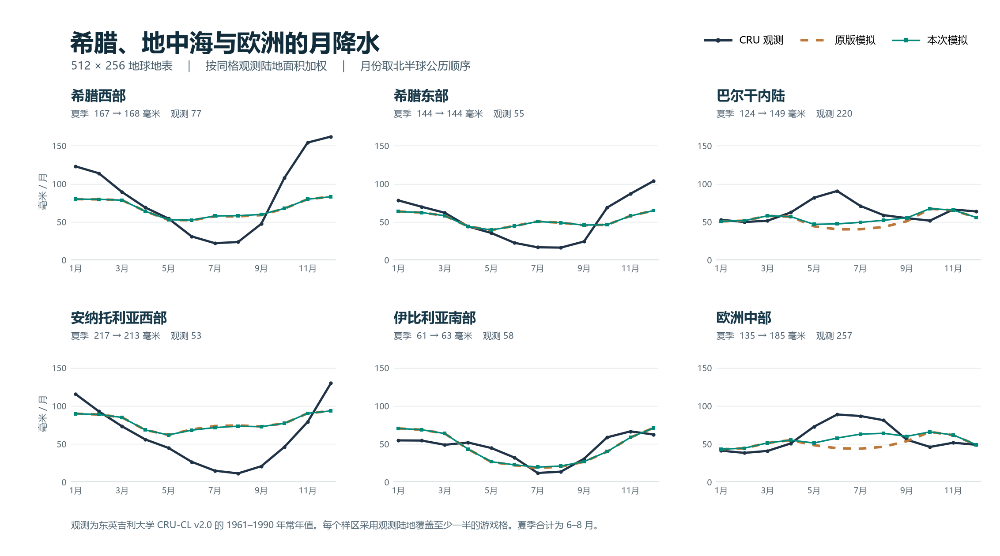
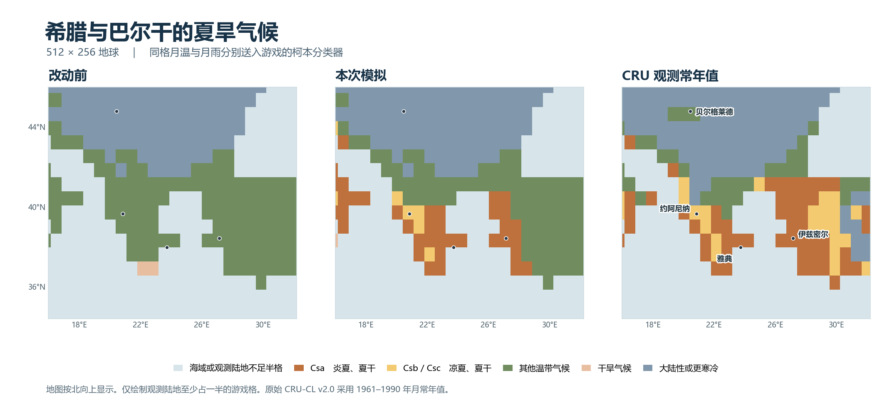

# 地中海与欧洲的地球气候核对

本页保留两轮模型对照。最近一轮以 `d805bb7` 为基准，雅典、拉里萨和约阿尼纳所在格均生成了与观测一致的夏旱气候。[希腊夏旱复核](#希腊夏旱复核)

上一轮针对巴尔干内陆与欧洲中部夏雨偏少的问题引入了陆面对流。暖季陆面升温、土壤有水且边界层湿润时，一部分实际蒸散水汽可参与对流。已由原有抬升产生的对流份额先从这部分水汽中扣除，高压下沉会抑制对流。新增降水经过原有云下再蒸发与水量收支。该轮 512 档巴尔干内陆的夏雨由 123.9 增至 148.8 mm，观测为 220.5 mm。该版本的希腊和安纳托利亚西岸夏旱仍然偏弱。



## 同一块陆地上的季节差异

对照版本为 `f7aea77674f6f545412018c32ef94f7e6b3848c7`。原版数据来自游戏第 194.2 日的 Unity 地球，表中使用世界保存的 12 个月常年值。相同地形和种子的独立 C# 生成与 Unity 的逐格海陆、高程一致，月降水最大差 0.0013 mm，月温最大差 0.00006 °C。新版也从 Unity 6000.0.55f1 的玩家地球导出了 512 × 256 格的逐月字段。与新版独立 C# 生成相对照，逐格高程、海陆和距岸相同，全年月降水最大差 0.00069 mm，月温最大差 0.000055 °C。下表的新版夏雨与游戏运行时导出的结果一致至 0.1 mm。原始 CRU-CL v2.0 为 1961–1990 年、10 角分的陆地月常年值。对每个游戏格，按球面交叠面积汇总细网格观测，再按观测陆地面积汇总样区。样区表纳入观测陆地覆盖达到 50% 的格，共用固定的地理窗口，包含开发块及留出块。城市名称表示含该城的游戏格。[CRU 来源与许可](README.md#数据字段与许可) · [New 等，2002](https://doi.org/10.3354/cr021001)

| 512 档样区 | 陆地参考格 | 6–8 月原版 → 新版 / 观测，mm | 12–2 月新版 / 观测，mm | 年雨量新版 / 观测，mm |
| --- | ---: | ---: | ---: | ---: |
| 希腊西部，伊庇鲁斯及爱奥尼亚沿岸 | 6 | 166.5 → 168.3 / 76.5 | 242.5 / 398.7 | 813.4 / 997.3 |
| 希腊东部，阿提卡至色萨利 | 9 | 144.2 → 143.9 / 55.4 | 190.7 / 251.8 | 626.2 / 628.6 |
| 伯罗奔尼撒 | 5 | 132.5 → 131.6 / 38.9 | 171.0 / 335.4 | 551.6 / 733.6 |
| 巴尔干内陆 | 45 | 123.9 → 148.8 / 220.5 | 158.2 / 166.3 | 656.9 / 755.2 |
| 第纳尔山脉与达尔马提亚沿岸 | 18 | 149.2 → 159.3 / 269.5 | 286.5 / 288.9 | 1,011.0 / 1,163.0 |
| 意大利南部 | 23 | 149.3 → 148.2 / 88.0 | 248.6 / 227.3 | 834.4 / 699.1 |
| 波河平原 | 14 | 197.5 → 210.3 / 207.2 | 223.5 / 191.0 | 897.6 / 909.7 |
| 伊比利亚南部窗口 | 55 | 60.8 → 63.2 / 57.7 | 210.2 / 171.7 | 532.7 / 530.9 |
| 安纳托利亚西部 | 25 | 216.9 → 213.0 / 52.8 | 271.8 / 338.0 | 940.2 / 710.8 |
| 黎凡特 | 28 | 50.9 → 52.1 / 10.6 | 134.2 / 254.5 | 344.1 / 466.6 |
| 马格里布北部 | 99 | 21.9 → 21.7 / 33.6 | 90.5 / 171.8 | 207.6 / 458.8 |
| 大西洋沿岸欧洲 | 126 | 174.6 → 211.0 / 200.3 | 302.7 / 215.9 | 1,139.7 / 828.2 |
| 欧洲中部 | 136 | 134.6 → 184.7 / 256.6 | 136.6 / 128.5 | 666.8 / 702.6 |
| 斯堪的纳维亚南部 | 94 | 184.5 → 178.9 / 212.2 | 154.7 / 146.0 | 703.3 / 708.7 |

按项目预先划分的空间块，希腊东西两个样区在开发区内。巴尔干内陆 45 格中有 4 格在留出区。这 4 格的夏雨由 134.0 增至 179.8 mm，观测为 311.0 mm。

希腊西部年降水多于东部，冬夏差距小于观测。两区新版 7 月均温分别为 22.0、22.9 °C，观测为 22.1、23.1 °C。1 月分别为 7.3、8.2 °C，观测为 4.7、5.2 °C。新旧模型共同的海岸夏雨偏差也出现在全陆地格。约阿尼纳所在格的地面平均高程为 787 m，CRU 为 820 m，模拟的柯本类型均为 Cfb，观测为 Csb。拉里萨格高程分别为 426、422 m，模拟均为 Cfa，观测为 Csa。512 档克里特样区没有观测陆地超过半格的单元。提高到 1024 后有 7 格，夏雨仍为 107.6 mm，观测为 17.0 mm。两档的水汽输送网格均为 128 × 64。

## 跨年观测与爱琴海风向

从环境观测器取连续 30 个游戏年的逐日区域强迫，保留种子驱动的年际异常，关闭瞬态风暴叠加。下表是各城所在游戏格 6–8 月总降水的 30 年均值。模拟每月 30 天，三个夏季月份共 90 天，观测使用公历的 6–8 月常年值。实际月温、月雨与同格 CRU 月值分别交给游戏自己的柯本分类器。

| 代表格 | 原版 → 新版 / 观测，mm | 柯本原版 → 新版 / 观测 |
| --- | ---: | --- |
| 约阿尼纳 | 177.7 → 180.5 / 98.3 | Cfb → Cfb / Csb |
| 雅典 | 138.4 → 137.0 / 38.6 | Cfa → Cfa / Csa |
| 伊兹密尔 | 210.1 → 205.3 / 25.3 | Cfa → Cfa / Csa |
| 贝尔格莱德 | 119.9 → 159.0 / 211.3 | Dfa → Dfa / Cfb |
| 索非亚 | 112.2 → 120.1 / 210.5 | Dfb → Dfb / Dfb |
| 维也纳 | 92.0 → 120.8 / 207.1 | Dfa → Dfb / Dfb |

NOAA NCEP/NCAR R1 1991–2020 的三个爱琴海海上节点，7 月向北风分量依次为 −3.53、−4.55、−4.73 m/s。按相同经纬度从新版 128 × 64 大气网格双线性采样，分别为 +1.30、+0.78、+0.50 m/s。三个位置依次为 24.375°E、37.1422°N，26.25°E、37.1422°N，及 26.25°E、35.2375°N。周围模型大气格的加权海面比例为 68%、73%、98%。观测显示 7 月气流向南，模型在三个位置均偏向北。岸边的逐月数据还显示，冬雨不足和夏雨偏多共同缩小了季节差距。[NOAA 再分析](https://psl.noaa.gov/data/gridded/data.ncep.reanalysis.derived.html)

## 对照与取舍

在开发块做的三个独立试验中，单独加强副热带下沉使希腊两侧的夏雨更接近观测，却把巴尔干内陆夏雨从 122.9 降至 77.5 mm，观测为 211.8 mm。模拟半封闭海盆的海陆热差能提高希腊冬雨，安纳托利亚西部夏雨却由 216.9 增至 235.7 mm。把气压梯度驱动的夏季经向流用于海面，安纳托利亚西部的夏雨降至 129.7 mm，巴尔干内陆也降至 95.3 mm。发布的运行时采用经过独立留出检验的陆地暖季对流改动。上述试验的观测只用于评分。

冻结参数后，512 档固定 17 个空间留出块、1,806 个参考格的月降水 MAE 由 31.39 降至 31.31 mm，RMSE 由 52.68 降至 52.62 mm。柯本五大类一致率由 75.74% 升至 75.94%，30 个细类一致率由 54.20% 降至 54.02%。年雨量 RMSE 由 417.98 升至 418.86 mm。256 和 1024 档的月降水 RMSE 分别由 52.88 降至 52.84 mm、53.21 降至 53.17 mm，两档的细类一致率分别下降 0.14 和 0.42 个百分点。各档均低于项目原设的 90% 分类门槛。大西洋沿岸欧洲的整体年雨量偏湿，斯堪的纳维亚南部的夏雨偏少加重。

合成平坦大陆回归使用镜像海岸和季节性陆面加热。原版南半球暖季内陆的对流份额只有 11.6%，低于回归门槛。新版南、北半球均为 53.9%，同一位置的冬季份额为零。无水源的干星球、气柱收支及对流加层状雨总量由现有回归核对。

## 复现

在仓库根目录运行。Python 工具使用 NumPy，首次读取原始 CRU 源会校验 SHA-256 并缓存。已有缓存可以用 `--cache` 指定。结果包含全部矩形边界、逐月数组、观测陆地覆盖、地形、水体类别和每个城市格的中心位置。区域检查默认只看开发集，下例显式生成全部地理块的诊断。

```powershell
$out = "ValidationOutput/EuropeanSeasons"
dotnet run --project Validation/EarthClimate/Export.csproj -c Release -- "$out/earth.bin" 512 ORBIS-2D-2026
python Validation/EarthClimate/check_european_seasons.py "$out/earth.bin" --split all --json "$out/regions.json"
dotnet run --project Validation/EarthClimate/EuropeanSites/EuropeanSites.csproj -c Release -- "$out/regions.json" "$out/sites.json"
python Validation/EarthClimate/score.py "$out/earth.bin" --split holdout --json "$out/holdout.json"
dotnet run --project Validation/EarthClimate/Export.csproj -c Release -- --compare-koppen "$out/earth.bin" --split holdout --json "$out/koppen.json"
```

复核原版时，在上述基准提交的独立检出中运行第一条地球导出命令，再用新版 Python 工具对原版导出生成区域报告。把本目录的 `EuropeanSites` 复制到原版检出的 `Validation/EarthClimate/`，即可在原版游戏核心上运行同样的 30 年站点检验。

留出集评分在任一分类一致率未超过 90% 时写出报告并返回 1。开发集评分输出当前一致率，供各版本对照。空间留出范围、CRU 归属及源数据许可沿用本目录的验证说明。[验证方法与许可](README.md)

## 希腊夏旱复核

以 `d805bb7171e12705b4314bcfdc3bfaf9e1948114` 的玩家地球生成为对照，取希腊西部、东部和伯罗奔尼撒三个既有窗口的并集。各档都在自己的原生网格上统计，保留 CRU 观测陆地面积达到半格的单元。游戏自己的柯本分类器分别读取两版模拟和同格 CRU 的月温、月雨。表中 Cs 包含温带夏旱的 Csa、Csb、Csc，完整细类一致率按观测陆地面积加权。三个窗口都位于项目预先划定的开发区。

| 地球宽度 | 参考格数 | Cs 格数，改动前 → 现在 / CRU | 完整细类一致率，改动前 → 现在 |
| ---: | ---: | ---: | ---: |
| 256 | 4 | 0 → 4 / 3 | 19.1% → 80.9% |
| 512 | 18 | 0 → 18 / 17 | 3.8% → 90.3% |

每档都有一个沿海参考格在游戏粗网格中归于海面。只计双方均为陆地的格，256 档模拟与 CRU 均有 3/3 格为 Cs，三格完整细类也全部相符。512 档模拟为 17/17，CRU 为 16/17，完整细类吻合 15/17 格，占对应观测陆地面积的 89.9%。希腊北部的塞萨洛尼基在 512 档仍为全年有雨的 Cfa，与同格观测一致。

同一批游戏陆格在 Gleba 生态群系图上，256 档的 3 格和 512 档的 17 格现在都显示「地中海硬叶林灌丛」。512 档原来有 11 格显示温带阔叶混交林、6 格显示温带草原与灌丛。在整个地球预设上按地表面积加权，Gleba 标为热带稀树草原的陆地比例在 256 档由 16.0% 降至 10.8%，512 档由 15.4% 降至 10.2%。旧版 512 档的 3,897 个热带稀树草原格中有 1,332 格位于游戏的 Aw 气候区之外，新版的 2,572 格全部位于 Aw 区。这些比例描述生成的游戏群系，CRU 数据仅用于月温、月雨与气候分类的对照。



雅典的原版 7 月大气格落雨 46.4 mm，其中抬升及湿层成雨贡献 46.0 mm，陆面蒸散产生的额外对流为 0。新版用实际副热带高压的位置和东西气压梯度计算近地海风。暖季高压下沉能在潮湿海洋边界层上形成逆温，海面蒸发仍由海面温度对应的饱和水汽量决定。冷季极侧大陆气流越过相对温暖的海面时，海陆热差增强阵雨。干空气的云底较高，降水下落经过更深的蒸发层。云下蒸发返回气柱，各项出入水继续参加原水量收支。观测与城市坐标只用于验证，运行时根据生成的海陆、气温、气压和湿度计算。

| 512 档样区 | 6–8 月改动前 → 新版 / 观测，mm | 12–2 月改动前 → 新版 / 观测，mm |
| --- | ---: | ---: |
| 希腊西部 | 168.3 → 76.7 / 76.5 | 242.5 → 293.2 / 398.7 |
| 希腊东部 | 143.9 → 41.1 / 55.4 | 190.7 → 249.9 / 251.8 |
| 伯罗奔尼撒 | 131.6 → 22.9 / 38.9 | 171.0 → 234.6 / 335.4 |
| 巴尔干内陆 | 148.8 → 152.8 / 220.5 | 158.2 → 157.3 / 166.3 |
| 第纳尔山脉与达尔马提亚沿岸 | 159.3 → 136.7 / 269.5 | 286.5 → 282.9 / 288.9 |
| 安纳托利亚西部 | 213.0 → 123.2 / 52.8 | 271.8 → 300.6 / 338.0 |
| 意大利南部 | 148.2 → 66.8 / 88.0 | 248.6 → 269.4 / 227.3 |
| 伊比利亚南部 | 63.2 → 14.2 / 57.7 | 210.2 → 212.4 / 171.7 |

沿用上文的 30 年逐日环境观测器，512 档在雅典、约阿尼纳和拉里萨同时检验了沿海与纯陆地格。雅典在 256、512、1024 三档均从同一生成入口得到 Csa。克里特在 512 档没有达到一半陆地覆盖的参考格。1024 档的 7 个参考格夏雨由上一轮的 107.6 降至 11.5 mm，观测为 17.0 mm。512 档伊拉克利翁的少数陆地格仍为 BSh，同格陆地观测为 Csa。

| 代表格 | 改动前 → 新版 / 观测柯本 | 30 年平均夏雨改动前 → 新版 / 观测，mm |
| --- | --- | ---: |
| 雅典 | Cfa → Csa / Csa | 137.0 → 21.7 / 38.6 |
| 约阿尼纳 | Cfb → Csb / Csb | 180.5 → 96.1 / 98.3 |
| 拉里萨 | Cfa → Csa / Csa | 158.3 → 80.3 / 80.0 |
| 阿尔塔 | Cfa → Csa / Csa | 163.8 → 68.9 / 57.6 |
| 特里波利 | Cfb → Csb / Csb | 134.4 → 22.6 / 55.8 |
| 塞萨洛尼基 | Cfa → Cfa / Cfa | 149.8 → 89.7 / 80.9 |
| 伊兹密尔 | Cfa → Csa / Csa | 205.3 → 57.6 / 25.3 |
| 贝尔格莱德 | Dfa → Dfa / Cfb | 159.0 → 168.4 / 211.3 |
| 索非亚 | Dfb → Dfb / Dfb | 120.1 → 111.2 / 210.5 |

7 月三个爱琴海海上节点的新版 10 m 北向风分量分别为 −4.89、−7.28、−7.33 m/s。原版均为正，NOAA 分别为 −3.53、−4.55、−4.73 m/s。三点现在都从北向南吹，风力偏强。整层水汽输送仍有显著偏差。在 25°E、37.5°N，NOAA 的 1000–300 hPa 月均比湿乘月均北向风积分为 −113.6 kg/(m·s)，原版和新版模式的北向格面输送分别为 +6.0、+7.2 kg/(m·s)。模式格面计入扰动和扩散，参考积分采用月均量，实际瞬变协方差会影响幅度。[NOAA 气压层风场](https://downloads.psl.noaa.gov/Datasets/ncep.reanalysis.derived/pressure/vwnd.mon.ltm.1991-2020.nc) · [NOAA 气压层比湿](https://downloads.psl.noaa.gov/Datasets/ncep.reanalysis.derived/pressure/shum.mon.ltm.1991-2020.nc)

在其他地中海型窗口，以当地夏季计，加利福尼亚由 124.3 降至 85.5 mm（观测 24.0），智利中部由 122.2 降至 115.5 mm（24.2），南非开普由 65.4 降至 63.6 mm（58.9），澳大利亚西南部由 25.2 降至 18.0 mm（53.8）。印度季风窗口、长江下游和华北内陆的 6–8 月降水分别由 600.3、568.4、449.5 变为 600.3、568.3、448.9 mm。伊比利亚南部和澳洲西南部的夏季偏干加重，西希腊的冬雨仍少。

固定全球 17 个留出块和 1,806 个参考格的指标如下。季节降水、水汽守恒、东亚季风、ExoPlaSim、地形降水、风带、洋流、天气等 12 组专项已通过。256、512 档的撒哈拉年雨分别为 82.6 和 73.6 mm，原有上限为 85 mm。首次较宽的海洋逆温实验使 256 档达到 92.5 mm，随后依据该既有回归与源项诊断修正。

季风回归使用种子 `ORBIS-2D-2025`。把干燥气柱的云底高度直接用于整个季风区时，2048 档印度中部年雨为 792 mm，低于原有 800 mm 门槛。最终版本根据生成的海洋季风通道保留湿润的近地空气。印度中部年雨在 256、512、2048 档分别为 828、812、803 mm，其中 6–9 月分别占 79%、81%、80%。各次地区试验使用开发区观测，留出区用于报告整体取舍。

| 地球宽度 | 月降水 MAE，mm | 月降水 RMSE，mm | 柯本五大类一致率 | 完整细类一致率 |
| ---: | ---: | ---: | ---: | ---: |
| 256 | 31.45 → 31.59 | 52.84 → 53.00 | 76.07% → 75.97% | 53.71% → 53.30% |
| 512 | 31.31 → 31.44 | 52.62 → 52.77 | 75.94% → 75.99% | 54.02% → 53.63% |
| 1024 | 31.49 → 31.62 | 53.17 → 53.32 | 75.70% → 75.80% | 53.42% → 53.29% |

可按上面的复现命令导出当前版本和本节基准的逐月场。运行 `dotnet run --project Validation/FlatWorld/FlatWorld.Core.Tests.csproj -c Release -- --seasonal-rainfall` 可复查玩家地球的雅典、特里波利、伊兹密尔、贝尔格莱德及每月水量守恒。将末项换为 `--east-asia-climate 256`、`--east-asia-climate 512` 或 `--east-asia-climate 2048` 可复查三档的印度中部年雨与季风占比。全球分类结果仍低于项目原设的 90% 通过门槛。
