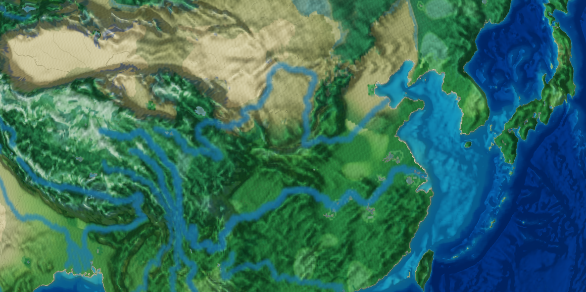
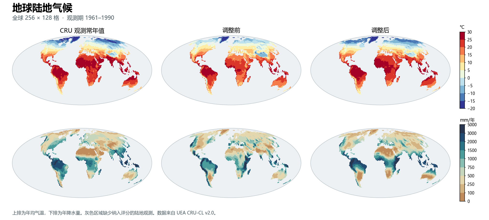
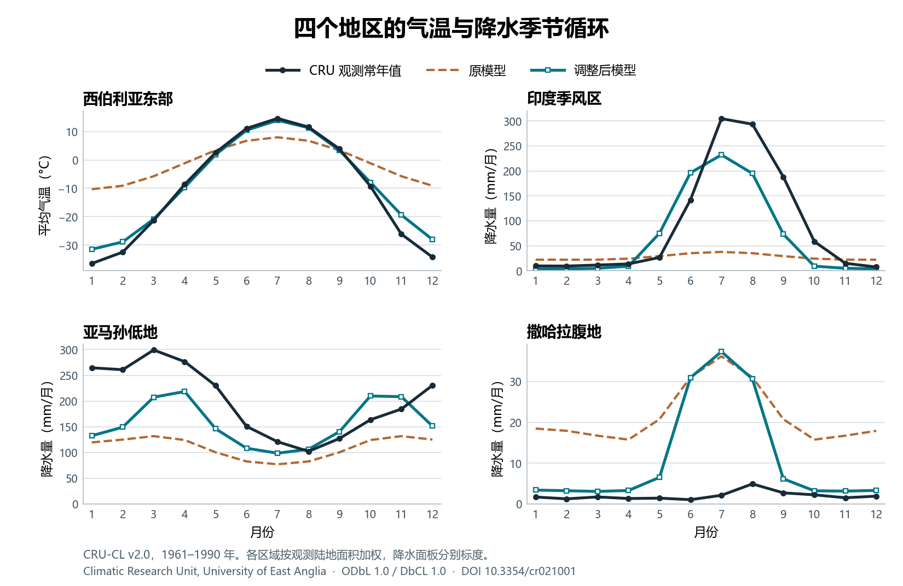

# 地球气候与地形验证结果

## 纯模拟柯本一致率与季节

**五档地球均未通过双 90% 验收。** 玩家入口只加载地形和水系。月温、月降水、柯本类型和地表生物群系均由游戏生成。比对使用 CRU-CL v2.0 陆地 1961–1990 年逐月常年值，先把月值配准到同一参考网格，再用游戏分类器分别判型。地图种子为 `ORBIS-2D-2026`。

| 地球网格 | 五大类，升级前 → 后 | 30 个精确细类，升级前 → 后 |
| --- | ---: | ---: |
| 256×128 | 72.10% → **74.61%** | 36.38% → **45.96%** |
| 512×256 | 72.15% → 74.42% | 36.13% → 46.69% |
| 1024×512 | 71.99% → 74.29% | 36.21% → 46.71% |
| 1536×768 | 72.00% → 74.30% | 36.28% → 46.63% |
| 2048×1024 | 72.07% → **74.18%** | 36.55% → **46.50%** |

直接对照为 `06bfd50`。本轮只用开发区选参数，然后冻结模型，对既有的 17 个地理留出块一次性比较五种尺寸。每档都按同一批 1,806 个参考单元的实际陆地面积加权，合计 28,894,293 km²。五组和精确细类分别要求未舍入的一致率严格高于 90%，五档最终验收退出码均为 1。留出区覆盖 24 个有观测面积的亚型，其余 6 类的召回率在 JSON 记为 `null`。该留出区沿用仓库既有基准，地理范围与历史成绩此前已公开。256 档本轮导出 SHA-256 为 `aa4e252c6ead6ac1918cbb93f87b12f4c421a4982aa63c991249fe574e4a5076`。[复现方法](README.md)

**降水季节性仍是主要误差来源。** 256 档中，热沙漠 BWh 被判成热半干旱 BSh，占全部留出面积的 5.30%。全年湿润的亚寒带 Dfc 被判成冬干的 Dwc，占 4.50%。热带草原 Aw 被判成热带雨林 Af，占 4.14%。冻结后分别替换一个输入做误差诊断，保留模拟温度、改用观测降水，细类一致率为 83.86%。保留模拟降水、改用观测温度，细类一致率为 55.24%。正式成绩只使用上表中的双模拟输入。

| 256 档留出区指标 | 升级前 | 升级后 |
| --- | ---: | ---: |
| 月均温 MAE | 2.28 °C | 2.03 °C |
| 月降水 MAE | 45.37 mm | 41.22 mm |
| 扣除当地年平均后的月温 RMSE | 2.02 °C | 1.88 °C |
| 扣除当地年平均后的月降水 RMSE | 50.44 mm | 46.55 mm |
| 南半球观测最湿季度的降水 MAE | 289.28 mm/季 | 297.25 mm/季 |

撒哈拉腹地留出单元的年雨量为模拟 319 mm、观测 31 mm。印度季风区的留出单元为模拟 489 mm、观测 1017 mm。水汽在最高 128×64 格上输送，这五档的分类结果也说明，只增加地形纹理或地图格数很难解决雨量偏差。

**季节变化已接入运行时。** 地形和上风海面的热量、太阳辐射、陆地积雪与海洋热储存影响当地月温。水汽与土壤水在真实顺序的 30 天月份间连续传递，前两年用于预热，第三年统计月降水。冬季锋面和夏季副热带高压影响大陆西岸，暖湿东岸继续受夏季向岸流影响。大陆西岸动力过程参考了 Seager 等关于冬季风暴路径和夏季下沉气流的研究。游戏按当天日期还原当地月常值，大气、云、雷电及气候诊断共用对应时相。[Seager 等，2019](https://doi.org/10.1175/JCLI-D-18-0472.1)

在开发区的五折空间验证中，月温 MAE 为 2.255 → 2.030 °C，十二个月分别改善。独立 NOAA NCEP/NCAR 气温复核中，海洋近地月温 RMSE 为 3.97 → 3.91 °C，南极陆地为 **14.38 → 15.14 °C**。南极洲处于 CRU 陆地校准范围以外。[NOAA 数据说明](https://psl.noaa.gov/data/gridded/data.ncep.reanalysis.html)

**玩家视图和旧存档。** 在 Unity 6000.0.55f1、Direct3D 11、RTX 5070 Laptop 上，通过玩家菜单生成 2048×1024 地球。北纬 28°–33°、东经 110°–121° 的长江中下游样区有 1,765 个露出地表的单元，年雨量 1,442 mm，沙漠地表占比 0%。同尺寸华北平原、华南和四川盆地样区也均为 0%。塔里木盆地仍有 86.0% 沙漠地表。这里的地表百分比和全球柯本一致率各自衡量不同的现象。独立的 v2、v4 存档通过回读测试。旧档武汉格使用「重算河流与气候」后从沙漠变为林地，地形、国家数量和游戏日期均保持一致。

四组评分器测试和 26 次核心回归命令均通过，涵盖南北半球季节、日期跨年、陆地水源、行星水量收支、河流、旧档、天气和五档地球。独立 Unity Play Mode 验证覆盖了图层切换、1 月和 7 月地表、云层分段缓存与植被风场。回归测试中的虚构大陆在南北纬 36° 都形成了西岸冬雨、东岸夏雨，无水源的干星球累计降水为零。

在 Ryzen 9 9955HX、.NET 9 Release 的 256 档地球上，对 `FlatMoisture.Build` 预热后计时，8 个工作线程每次构建的两轮中位数分别为 187 ms 和 142 ms，对照版本一轮为 147 ms。单线程从约 503 ms 降至 303–319 ms。该步骤发生在世界生成、重建或读档时。相同输入在 1 和 4 个线程上得到逐元素相同的降水、湿度；无源水量测试的误差为零，在含海洋的测试中 1 月的相对水量收支误差为 1.4×10⁻⁶。



## 东亚季风复核

以 `70c76e1` 为修正前版本，比较种子 `ORBIS-2D-2025` 的 2048×1024 地球。雨量列把两次模拟聚合到相同的 CRU-CL 陆地观测范围，单位为毫米/年。最右列按游戏中露出地表的面积统计，包括河道格。两个统计量分别检验水汽输送和玩家看到的地貌。

| 样区 | CRU 观测 | 修正前 | 修正后 | 沙漠地表占比，修正前 → 后 |
| --- | ---: | ---: | ---: | ---: |
| 华北平原 | 661 | 154 | 732 | 98.1% → 0% |
| 长江中下游 | 1358 | 253 | 1409 | 75.9% → 0% |
| 华南 | 1722 | 853 | 1776 | 0% → 0% |
| 四川盆地 | 1097 | 242 | 1014 | 74.6% → 0% |
| 塔里木盆地内陆 | 38 | 183 | 184 | 78.3% → 78.1% |

华北与长江中下游的 6–9 月降水分别占全年的 72% 和 53%，观测为 73% 和 46%。四个东部样区位于开发集。塔里木属于留出区，绝对雨量仍偏高。256 档全体 7919 个参考单元的月降水 MAE 从 44.45 降到 44.20 mm，独立留出区的同一指标从 45.24 升到 45.37 mm。256、512 两档均通过原有历史门槛。

Unity 6000.0.55f1、Direct3D 11 下，通过玩家菜单生成了修正前后的地球。镜头固定在东经 109.2°、北纬 34.5°，展开 44%，关闭云遮挡，分别核对一月、七月自然地表及柯本和植被图层。旧存档可在展开后使用「地形 → 重算河流与气候」更新。

## 较早的全球校准

在参数冻结后，用 17 个地理留出块验证游戏的月气候。与历史版本相比，256 宽地图的月均温 RMSE 从 **6.65 降至 2.99 °C**，月降水 RMSE 从 **80.54 降至 77.65 mm/月**。两个地图尺寸的气温误差都明显下降，降水总体改善较小，部分地区的雨季强度偏差更大。



## 地理留出结果

每个表格单元均按“历史版本 → 调整后版本”排列。两个地图尺寸分别运行完整的 C# 地球生成流程，再对齐同一批 1,806 个参考单元。评分覆盖留出区 2,889 万 km² 陆地，按观测陆地面积加权。历史版本固定为 `fcb360fd`，种子固定为 `ORBIS-2D-2026`。比较包含地形、水域和气候算法的合计影响。

| 地图 | 月均温 MAE（°C） | 月均温 RMSE（°C） | 月降水 MAE（mm） | 月降水 RMSE（mm） | 年降水 RMSE（mm） |
| --- | ---: | ---: | ---: | ---: | ---: |
| 256×128 | 4.87 → **2.28** | 6.65 → **2.99** | 48.04 → **45.23** | 80.54 → **77.65** | 793.70 → **712.50** |
| 512×256 | 4.93 → **2.25** | 6.72 → **2.96** | 48.22 → **45.10** | 80.94 → **77.53** | 797.64 → **709.60** |

在 256 图上，月均温 RMSE 在 17 块中的 13 块下降，月降水在 9 块下降。开发集的月降水 RMSE 从 81.12 降至 70.16 mm，改善幅度大于留出区的 3.6%。在留出区，模型预报的平均年雨量为 799 mm，观测为 642 mm。

减去各单元的全年月平均后，气温季节异常的 RMSE 从 4.67 降至 2.02 °C。降水季节异常的相关系数从 0.44 升至 0.51，但 RMSE 从 **45.95 升至 50.04 mm/月**。6 月的整月降水 RMSE 从 88.86 升至 104.58 mm。年雨量小于 250 mm 的干旱区召回率为 30.5% → 30.8%，年雨量至少 1,500 mm 的湿润区为 34.9% → 44.5%。调整后的模型将 13.4% 的留出面积划为湿润区，观测比例为 6.6%。

## 区域与季节

下表和图使用 256 图各地理矩形中所有可比较的陆地，包含开发区和留出区。西伯利亚大陆的冬夏温差、印度雨季占比和亚马孙年雨量更接近观测。印度年雨量仍偏低约 25%，亚马孙仍偏低约 22%。

| 区域与指标 | 观测 | 历史版本 | 调整后版本 |
| --- | ---: | ---: | ---: |
| 西伯利亚东部，6–8 月减 12–2 月平均温差 | +47.0 °C | +16.7 °C | +41.5 °C |
| 印度季风区，6–9 月占全年雨量 | 85.9% | 42.1% | 85.8% |
| 印度季风区，年雨量 | 1,081 mm | 327 mm | 812 mm |
| 亚马孙低地，年雨量 | 2,411 mm | 1,324 mm | 1,877 mm |
| 刚果盆地，年雨量 | 1,651 mm | 786 mm | 1,481 mm |
| 撒哈拉腹地，年雨量 | 24 mm | 259 mm | 134 mm |
| 澳洲内陆，6–9 月占全年雨量 | 18.6% | 31.5% | 4.4% |

西伯利亚东部的 45 个留出单元，夏冬温差从 +22.2 增至 +42.2 °C，观测为 +42.6 °C。撒哈拉腹地的总体平均掩盖了局部退步。只看该区域的留出单元，年雨量从 199 升至 322 mm，而观测为 31 mm。萨赫勒留出单元的年雨量从 700 升至 1,169 mm，观测为 502 mm。西非 22.5°W–0°、0°–22.5°N 地理块的月降水 RMSE 从 70.18 升至 107.48 mm。



## 气候带、海洋和极地

同一套游戏柯本分类器分别读取 CRU 观测与游戏产生的月温、月雨。256 档地球在 1,806 个留出格点上的五大气候带面积一致率从 **58.40% 升至 71.73%**。细分为 30 类时，一致率从 **28.30% 升至 36.14%**。这个口径衡量月气候能否还原观测推得的气候类型，季节干湿边界仍有较大偏差。

另以 NOAA PSL 提供的 NCEP/NCAR R1 **1981–2010** 年 2 米气温再分析做独立对照。固定使用该资料自身的海陆掩膜，游戏月温双线性采样到其 192×94 高斯格点，按高斯求积面积加权。这套数据未参加参数拟合。12,134 个海洋格点（含季节性海冰）月温 RMSE 从 **4.77 降至 3.97 °C**。南纬 60° 以南 1,657 个陆地格点从 **15.22 降至 14.38 °C**。南极结果对冰面辐射冷却与近地逆温的进一步建模提出了明确要求。该指标比较海面上方的空气温度。[NOAA PSL 再分析说明](https://psl.noaa.gov/data/gridded/data.ncep.reanalysis.html)

## 地形和架空世界

2048×1024 地球的 2,097,152 格高程逐格匹配随包 ETOPO 地形，格平均高程从 −9857 至 +6216 米。按球面面积加权，海洋占 70.46%。五档地图以 Natural Earth 海岸、内陆水体与真实高程判定初始水域。512×256 图上，塔里木样区 90 格中的常年湖面由 69 格降至 0 格，柴达木样区 36 格中由 7 格降至 0 格。里海水位从 +118 米修正为约 −28 米；地中海、黑海和波罗的海的水面均为 0 米。[ETOPO 2022](https://doi.org/10.25921/fd45-gt74) · [Natural Earth](https://www.naturalearthdata.com/)

架空世界继续生成独立的板块、海底扩张脊和山系。1536×768 群岛种子 `SCALE-QA-1536` 的海深中位数从 3199 米变为 4039 米，最深 1% 的门槛从 3977 米变为 5661 米。2048 档地球的对应值为 4112 和 5971 米。同一群岛的陆地高程中位数从 153 米变为 324 米，地球参照约 420 米。

把同一架空大陆连同海岸整体平移 39 个经度格后，1 线程与 4 线程生成的各地月温最大差为 0 °C，月降水最大差为 0.0038 mm。独立地形试验在热带平原加入山脊后，背风低地年雨从 1297 降到 639 mm，迎风山脊收到 2551 mm。四个架空预设均在 1536 和 2048 两档完成生成及存档数据校验。

Unity 6000.0.55f1、Direct3D 11、RTX 5070 Laptop、32 GB 内存下，从玩家菜单生成 2048×1024 地球并进入场景用时 12.28 秒。保存 273,182,212 字节用时 5.41 秒，从另一张同尺寸地图回读用时 11.13 秒，编辑器进程峰值工作集 5742 MiB。同机 Windows 测试版通过菜单生成了 1536×768 地球并核对全部 1,179,648 个高程。五种地球高程与水域资源均可在玩家端离线读取。[Unity 菜单回归](../FlatWorld/LargeWorldMenuProbe.cs)

## 来源、范围与复现

陆地温度和降水参考来自 **Climatic Research Unit, University of East Anglia**。CRU-CL v2.0 以气象站资料插值得到 1961–1990 年陆地月常年值。原始网格为 10 角分，数据库按 ODbL 1.0 提供，独立内容适用 DbCL 1.0。本目录的 CRU 派生数据保留相同署名和许可。[数据与使用条件](https://crudata.uea.ac.uk/cru/data/hrg/) · [New 等，2002](https://doi.org/10.3354/cr021001) · [ODbL 1.0](https://opendatacommons.org/licenses/odbl/1-0/) · [DbCL 1.0](https://opendatacommons.org/licenses/dbcl/1-0/)

CRU 主评分覆盖南极洲以外、观测陆地占参考单元面积至少一半的陆地气候。海洋和南极的补充对照仅覆盖月均气温。细小岛屿、局地极端天气和每日预报能力仍未经验证。跨尺寸比较在同一粗参考网格上进行。

历史与当前二进制的导出、两个尺寸的逐月评分和数值回归命令，以及原始观测的重新生成方法，均见验证说明。评分 JSON 同时保存每月、每块、各区域的结果和输入文件完整 SHA-256。[验证说明](README.md)

要重绘上图，在完成 256 图导出后运行以下命令。绘图额外依赖 Matplotlib。

```powershell
python Validation/EarthClimate/score.py ValidationOutput/EarthClimate/baseline.bin --split all --json ValidationOutput/EarthClimate/baseline-all.json
python Validation/EarthClimate/score.py ValidationOutput/EarthClimate/current.bin --split all --json ValidationOutput/EarthClimate/current-all.json
python Validation/EarthClimate/plot.py ValidationOutput/EarthClimate/baseline-all.json ValidationOutput/EarthClimate/current-all.json Validation/EarthClimate/seasonal-cycles.png
python Validation/EarthClimate/plot_maps.py ValidationOutput/EarthClimate/baseline.bin ValidationOutput/EarthClimate/current.bin Validation/EarthClimate/spatial-normals.png
```
